# 一、用Glassfish部署JSF项目

了解 JSF 项目如何加入依赖并部署，开发时检查容器与包名。

**学习前提与版本：** 先读 JSF 基础。截图来自 IDEA、GlassFish 4/5 与 JSF 2 的历史环境；菜单和下载页会变化。Tomcat 路线需自行加入匹配的 Faces 实现。新整合示例见 Springboot+JSF+Mybatis.md。

**截图说明：** 图片保留原教学环境的操作过程；若截图中的旧写法与正文不同，以修订后的正文和所选版本的官方文档为准。

**示例使用：** 除明确列出全部文件和运行步骤的项目外，代码块是各小节的独立片段。省略号、占位名称需要补齐；标明错误的行用于说明问题。同节替代写法不要合并。

[文档目录](README.md) · [官方参考](https://eclipse-ee4j.github.io/glassfish/)

**内容导航**

- [1、下载glassfish](#section-1)
- [2、配置glassfish环境变量](#section-2)
- [3、修改jdk环境变量](#section-3)
- [4、测试glassfish是否可以正常启动](#section-4)
- [5、在IDEA中创建一个JSF项目](#section-5)
- [6、问题：部分标签元素无法显示](#section-6)
- [二、用tomcat部署JSF项目](#section-7)
- [1、新建项目或者模块，选择普通java项目](#section-8)
- [2、输入名字，finish](#section-9)
- [3、右键新建的1项目，选择添加框架支持](#section-10)
- [4、选择JSF，点击Use library，选择下面两个jar包](#section-11)
- [5、打开项目结构，点击构件，点右下角fix，选第一个](#section-12)
- [6、编辑运行环境，添加tomcat服务器，将项目工件添加进去，设置好路径](#section-13)
- [7、在web.xml中配置 默认启动页](#section-14)
- [8、直接启动tomcat服务器，部署完成](#section-15)
- [附加：在tomcat上部署从maven骨架创建的jsf项目](#section-16)


<a id="section-1"></a>

## 1、下载glassfish

本节截图来自 GlassFish 4/5、Java EE 和 JSF 2 的历史环境。复现时先确认所选 GlassFish 的 Java 与 Java EE 要求，不要混用 Jakarta Faces 3/4 的依赖。

官网地址：

```html
GlassFish
https://javaee.github.io/glassfish/
```


 点击download

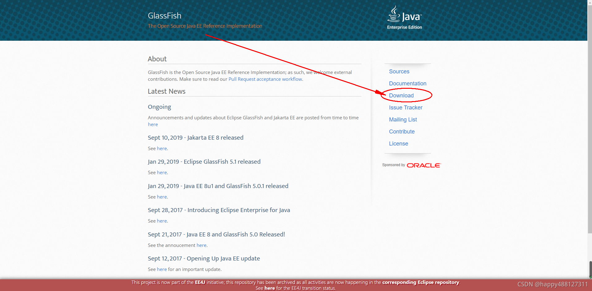

 选择图中版本

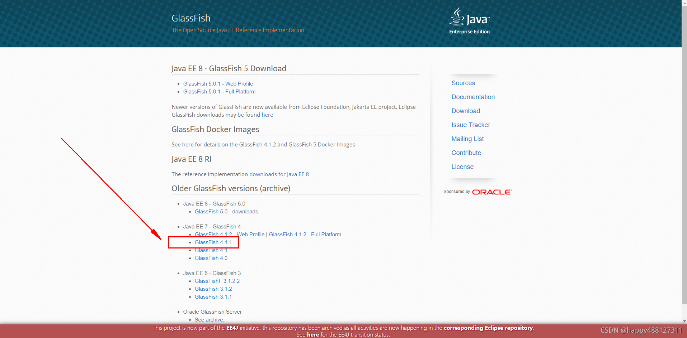

下载完解压到自己指定的目录即可

<a id="section-2"></a>

## 2、配置glassfish环境变量

 将glassfish的bin目录添加到系统变量path中

<a id="section-3"></a>

## 3、修改jdk环境变量

将之前系统环境变量path里的jdk1.8的环境变量上移到第一个

本文旧版 GlassFish 示例使用 JDK 8。其他 GlassFish 版本的要求不同；以对应版本的官方说明为准。通过 java -version 和服务器启动日志确认实际使用的 JDK，不要只看 PATH 顺序。

<a id="section-4"></a>

## 4、测试glassfish是否可以正常启动

在cmd里直接输入  asadmin start-domain ，出现下图所示即表明配置成功

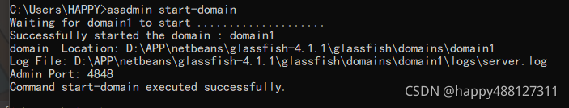

 再输入 asadmin stop-domain  可以停止glassfish

<a id="section-5"></a>

## 5、在IDEA中创建一个JSF项目

1. 选择 java Enterprise, 点击next

   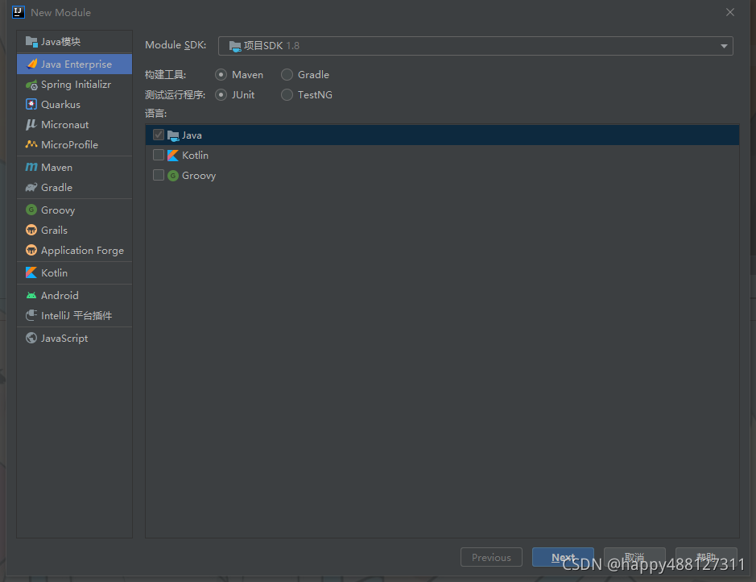

2. 勾选 Web Profile，IDEA会自动帮你勾选其他所需要的框架（包括JSF），点击next

   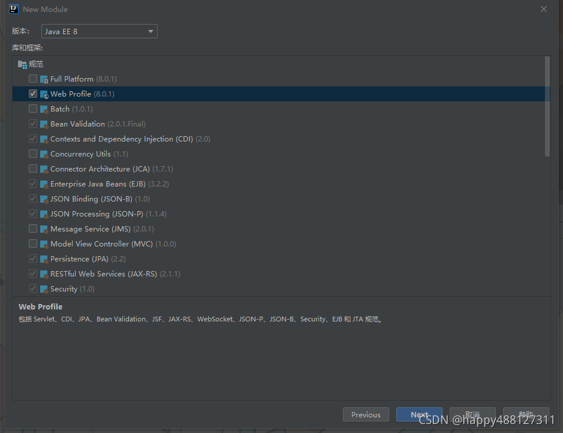

3. 输入模块名，点击finish

   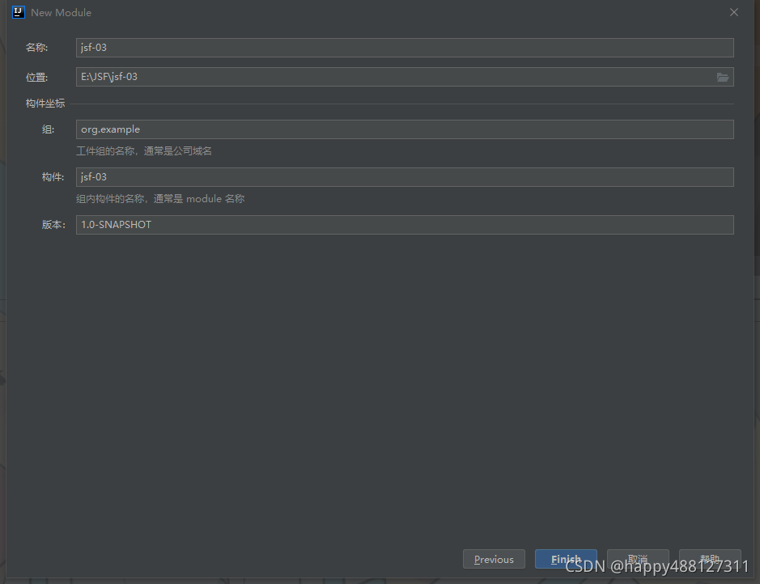

4. IDEA生成默认的项目结构

   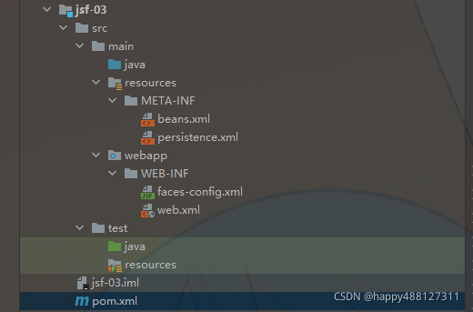

5. 默认pom文件内容

   ```xml
   <?xml version="1.0" encoding="UTF-8"?>
   <project xmlns="http://maven.apache.org/POM/4.0.0"
            xmlns:xsi="http://www.w3.org/2001/XMLSchema-instance"
            xsi:schemaLocation="http://maven.apache.org/POM/4.0.0 http://maven.apache.org/xsd/maven-4.0.0.xsd">
       <modelVersion>4.0.0</modelVersion>

       <groupId>org.example</groupId>
       <artifactId>jsf-03</artifactId>
       <version>1.0-SNAPSHOT</version>
       <name>jsf-03</name>
       <packaging>war</packaging>

       <properties>
           <maven.compiler.target>1.8</maven.compiler.target>
           <maven.compiler.source>1.8</maven.compiler.source>
           <junit.version>5.6.2</junit.version>
       </properties>

       <dependencies>
           <dependency>
               <groupId>javax</groupId>
               <artifactId>javaee-web-api</artifactId>
               <version>8.0.1</version>
               <scope>provided</scope>
           </dependency>
           <dependency>
               <groupId>org.junit.jupiter</groupId>
               <artifactId>junit-jupiter-api</artifactId>
               <version>${junit.version}</version>
               <scope>test</scope>
           </dependency>
           <dependency>
               <groupId>org.junit.jupiter</groupId>
               <artifactId>junit-jupiter-engine</artifactId>
               <version>${junit.version}</version>
               <scope>test</scope>
           </dependency>
       </dependencies>

       <build>
           <plugins>
               <plugin>
                   <groupId>org.apache.maven.plugins</groupId>
                   <artifactId>maven-war-plugin</artifactId>
                   <version>3.3.0</version>
               </plugin>
           </plugins>
       </build>
   </project>
   ```

6. 修改默认生成文件,不修改会报错

   ```xml
   <faces-config xmlns="http://xmlns.jcp.org/xml/ns/javaee"
                 xmlns:xsi="http://www.w3.org/2001/XMLSchema-instance"
                 xsi:schemaLocation="http://xmlns.jcp.org/xml/ns/javaee
           http://xmlns.jcp.org/xml/ns/javaee/web-facesconfig_2_2.xsd"
                 version="2.2">
   </faces-config>
   ```


7. 在webapp目录下新建index.xhtml文件

   ```xml
   <?xml version="1.0" encoding="UTF-8"?>
   <!DOCTYPE html PUBLIC "-//W3C//DTD XHTML 1.0 Transitional//EN"
           "http://www.w3.org/TR/xhtml1/DTD/xhtml1-transitional.dtd">
   <html xmlns="http://www.w3.org/1999/xhtml"
         xmlns:h="http://xmlns.jcp.org/jsf/html"
         xmlns:ui="http://xmlns.jcp.org/jsf/facelets"
         xmlns:f="http://xmlns.jcp.org/jsf/core">
   <f:view>
       <h:outputLabel value="Hello, world"/>
   </f:view>
   </html>
   ```

8. 配置运行环境

   点击运行->编辑配置

   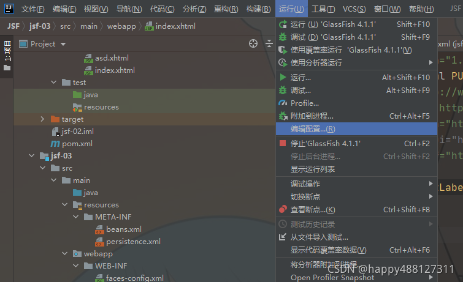

9. 点击左上角➕，选择glassfish，local

   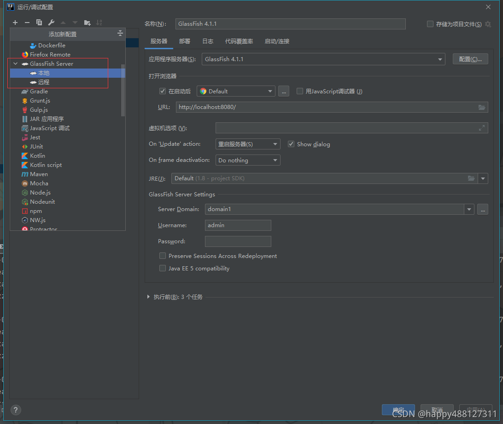

10. 点击配置，找到自己解压的glassfish的根目录

    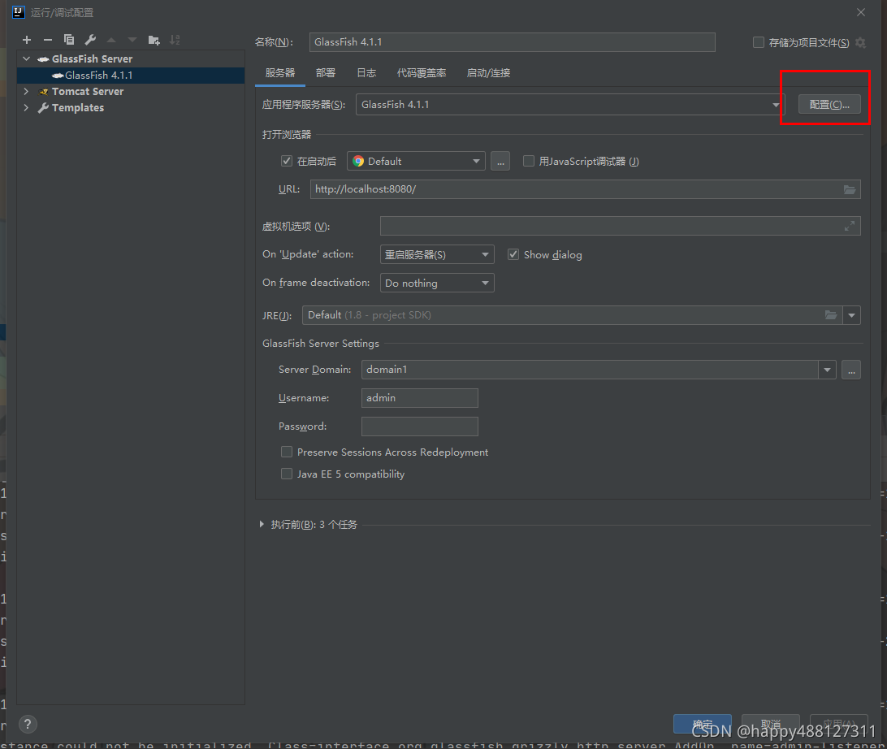

11. 点击部署，点击➕，点击工件，选择war_explore结尾的

    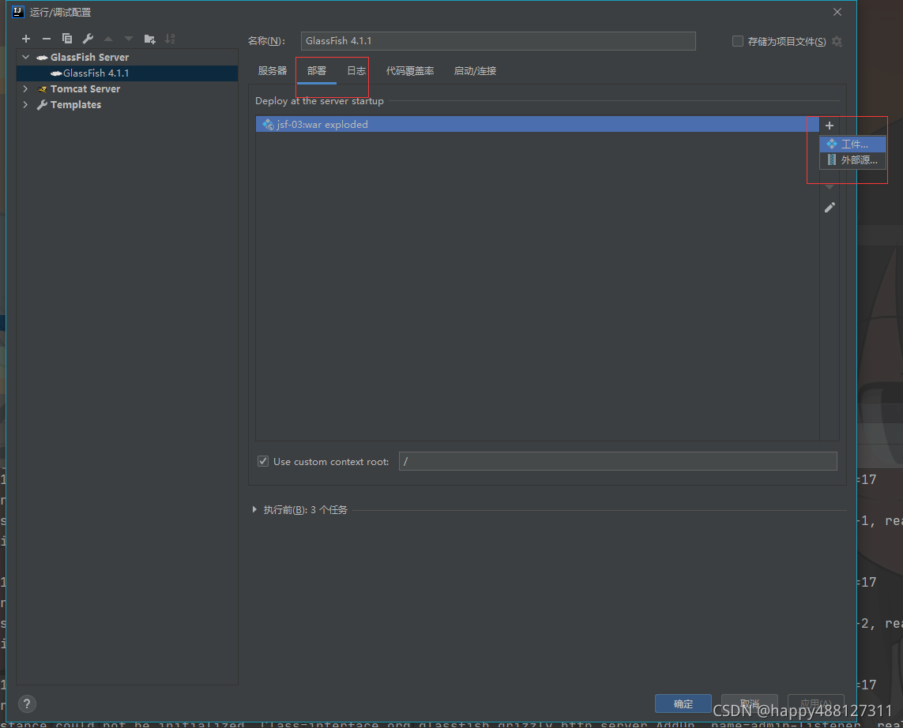

12. 点击应用，点击服务器，修改默认生成的url

    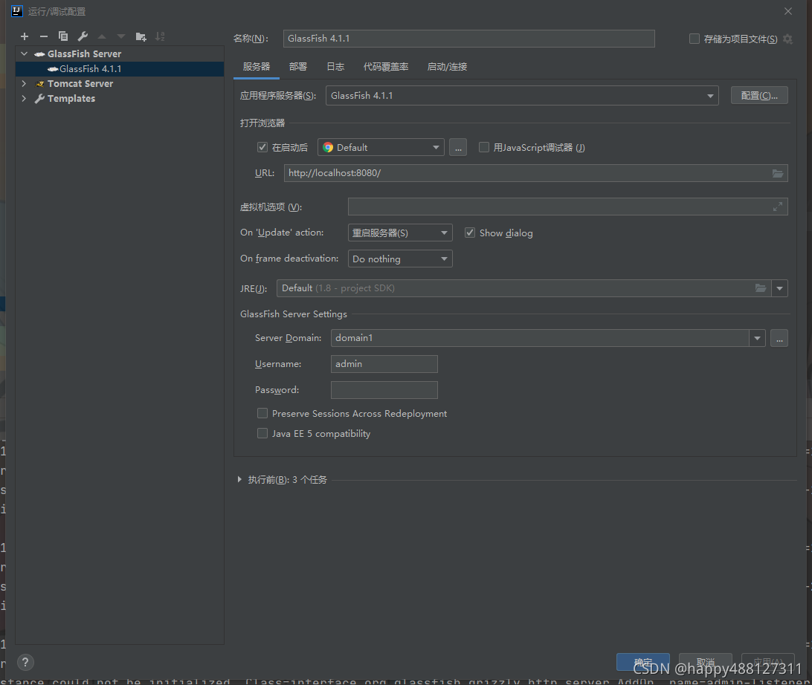

13. 点击确定， 启动服务器，在浏览器里输入相应链接进行访问

    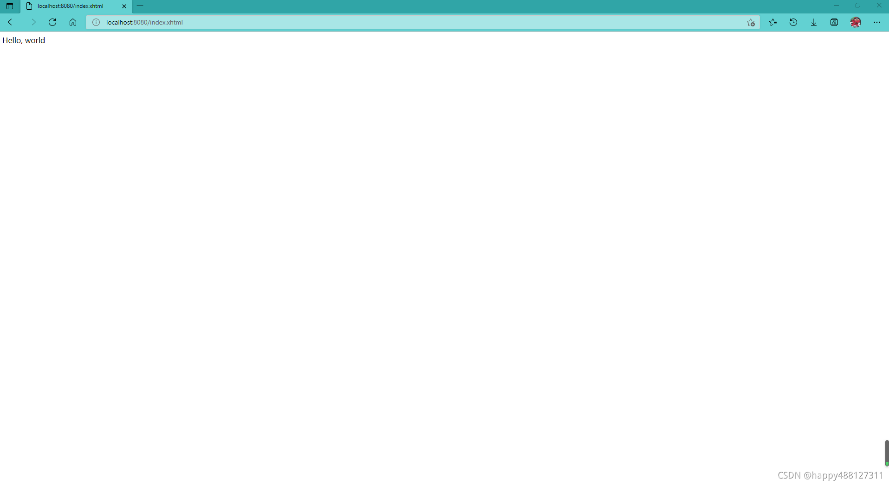

<a id="section-6"></a>

## 6、问题：部分标签元素无法显示

1. 页面代码如图所示

   ```html
   <?xml version="1.0" encoding="UTF-8"?>
   <!DOCTYPE html PUBLIC "-//W3C//DTD XHTML 1.0 Transitional//EN" "http://www.w3.org/TR/xhtml1/DTD/xhtml1-transitional.dtd">
   <html xmlns="http://www.w3.org/1999/xhtml" xml:lang="en" lang="en"
         xmlns:h="http://xmlns.jcp.org/jsf/html"
         xmlns:f="http://xmlns.jcp.org/jsf/core">
   <head>
       MessagesTags
   </head>
   <h:head>
   </h:head>
   <h:body>
       <h:form>
           <h:panelGrid columns="1" width="60%">
               <f:facet name="header">Login</f:facet>
               <f:facet name="footer">
                   <h:outputText value="快到中秋节了"/>
                   <h:commandButton action="Layoutpage" value="Submit"/>
               </f:facet>
               <h:panelGroup>
                   <h:outputText value="Enter ID:"/><h:inputText id="it1" required="true" requiredMessage="ynb"/>
                   <h:message for="it1"/>
               </h:panelGroup>
               <h:panelGroup>
                   <h:inputSecret required="true">
                       <h:outputLabel value="Enter Password"/>
                   </h:inputSecret>
               </h:panelGroup>
           </h:panelGrid>
           <h:messages/>
       </h:form>
   </h:body>
   </html>
   ```

2. 运行效果图

   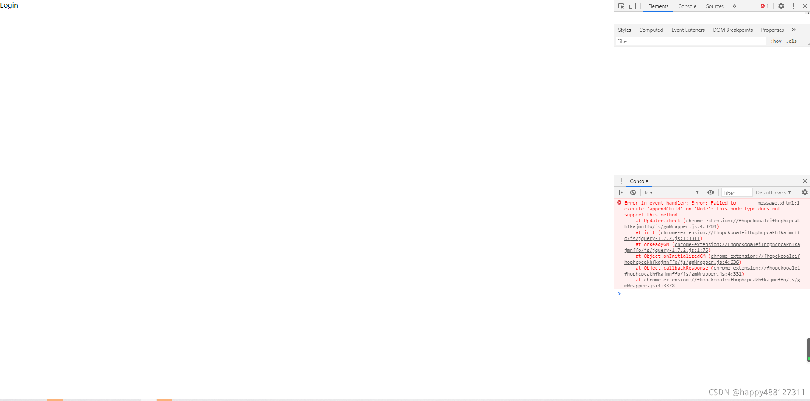

3. 报错代码：

   ```
   Error in event handler: Error: Failed to execute 'appendChild' on 'Node': This node type does not support this method.
       at Updater.check (chrome-extension://fhopckooaleifhophcpcakhfkajmnffo/js/gmWrapper.js:4:3204)
       at init (chrome-extension://fhopckooaleifhophcpcakhfkajmnffo/js/jquery-1.7.2.js:1:3311)
       at onReadyGM (chrome-extension://fhopckooaleifhophcpcakhfkajmnffo/js/jquery-1.7.2.js:1:76)
       at Object.onInitializedGM (chrome-extension://fhopckooaleifhophcpcakhfkajmnffo/js/gmWrapper.js:4:636)
       at Object.callbackResponse (chrome-extension://fhopckooaleifhophcpcakhfkajmnffo/js/gmWrapper.js:4:331)
       at chrome-extension://fhopckooaleifhophcpcakhfkajmnffo/js/gmWrapper.js:4:3378
   ```


4.  原因,web.xml 文件配置错误

   ```xml
   <?xml version="1.0" encoding="UTF-8"?>
   <web-app xmlns:xsi="http://www.w3.org/2001/XMLSchema-instance" xmlns="http://xmlns.jcp.org/xml/ns/javaee" xsi:schemaLocation="http://xmlns.jcp.org/xml/ns/javaee http://xmlns.jcp.org/xml/ns/javaee/web-app_4_0.xsd" version="4.0">
       <display-name>JSF_SE_CH2_html01_0915</display-name>
       <servlet>
           <servlet-name>Faces Servlet</servlet-name>
           <servlet-class>javax.faces.webapp.FacesServlet</servlet-class>
           <load-on-startup>1</load-on-startup>
       </servlet>
       <servlet-mapping>
           <servlet-name>Faces Servlet</servlet-name>
           <url-pattern>/faces/*</url-pattern>
       </servlet-mapping>
       <context-param>
           <description>State saving method: 'client' or 'server' (=default). See JSF Specification 2.5.2</description>
           <param-name>javax.faces.STATE_SAVING_METHOD</param-name>
           <param-value>client</param-value>
       </context-param>
       <context-param>
           <param-name>javax.servlet.jsp.jstl.fmt.localizationContext</param-name>
           <param-value>resources.application</param-value>
       </context-param>
       <listener>
           <listener-class>com.sun.faces.config.ConfigureListener</listener-class>
       </listener>
       <welcome-file-list>
           <welcome-file>faces/index.xhtml</welcome-file>
       </welcome-file-list>
   </web-app>
   ```

5. 此截图环境通过容器自动注册 FacesServlet 后，可以减少重复的手工配置。这不是通用修复。先确认请求 URL 是否命中 FacesServlet、依赖是否一致、服务器日志是否有初始化错误；不要直接删除有效的 Servlet 或 Listener 配置。下面仅记录该旧环境使用自动注册时的描述符。

   ```xml
   <?xml version="1.0" encoding="UTF-8"?>
   <web-app xmlns:xsi="http://www.w3.org/2001/XMLSchema-instance" xmlns="http://xmlns.jcp.org/xml/ns/javaee" xsi:schemaLocation="http://xmlns.jcp.org/xml/ns/javaee http://xmlns.jcp.org/xml/ns/javaee/web-app_4_0.xsd" version="4.0">
       <display-name>JSF_SE_CH2_html01_0915</display-name>

       <welcome-file-list>
           <welcome-file>faces/index.xhtml</welcome-file>
       </welcome-file-list>
   </web-app>
   ```

6. 运行截图，至此，大功告成！

   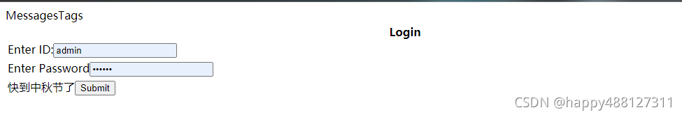


<a id="section-7"></a>

# 二、用tomcat部署JSF项目

<a id="section-8"></a>

## 1、新建项目或者模块，选择普通java项目

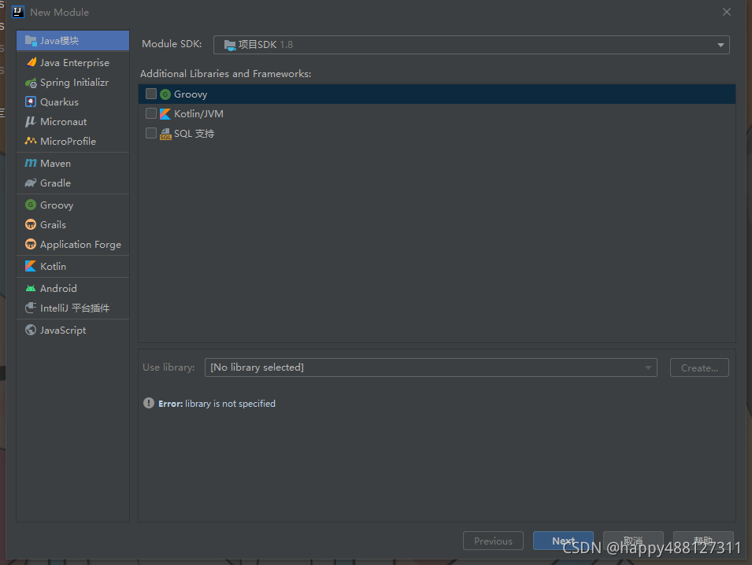

<a id="section-9"></a>

## 2、输入名字，finish

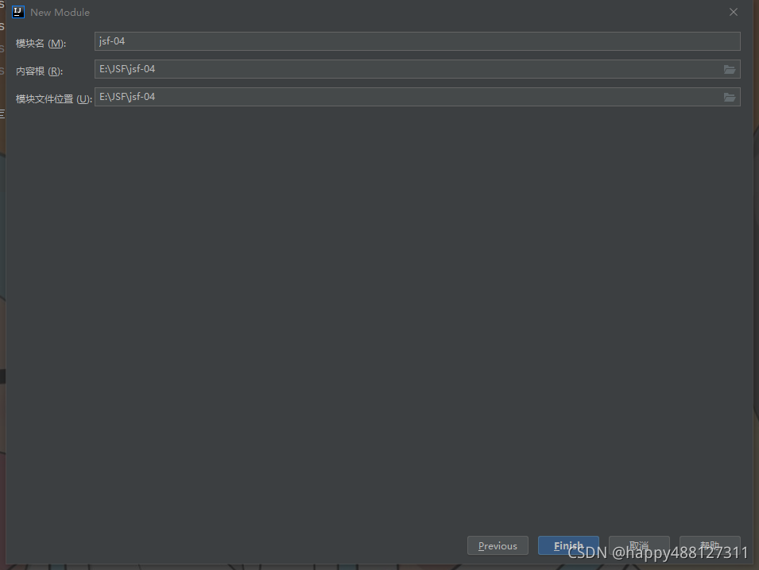

<a id="section-10"></a>

## 3、右键新建的1项目，选择添加框架支持

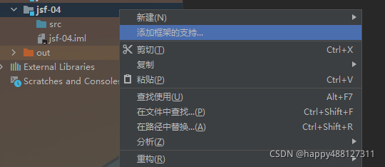

<a id="section-11"></a>

## 4、选择JSF，点击Use library，选择下面两个jar包

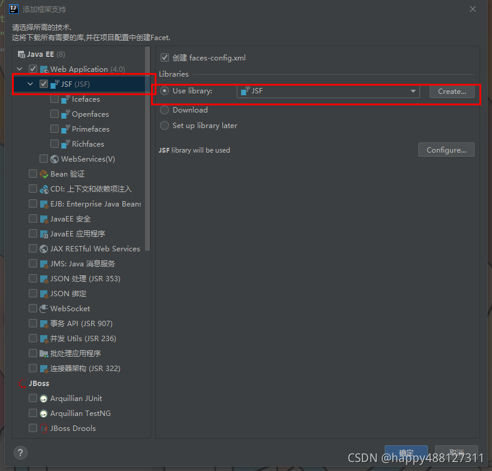

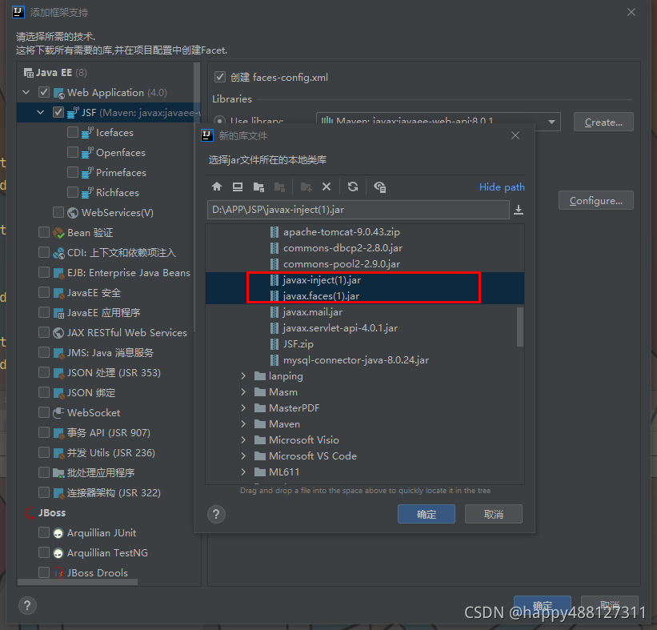

生成的项目结构如下

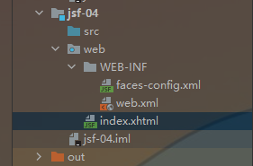

<a id="section-12"></a>

## 5、打开项目结构，点击构件，点右下角fix，选第一个

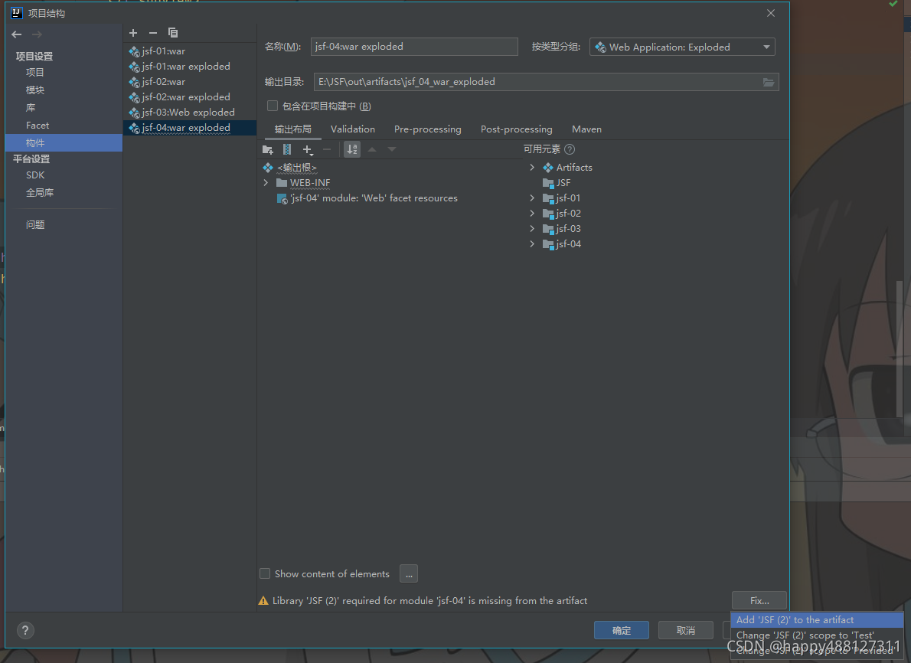

<a id="section-13"></a>

## 6、编辑运行环境，添加tomcat服务器，将项目工件添加进去，设置好路径

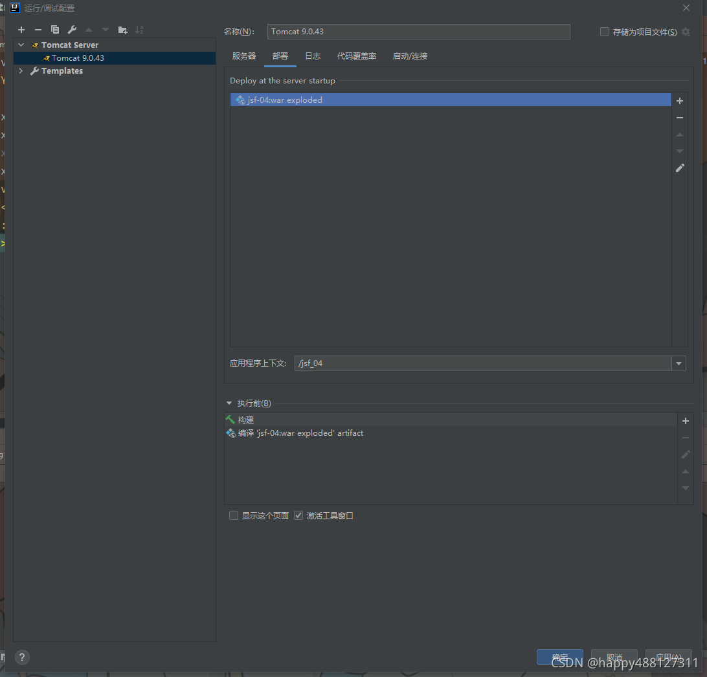

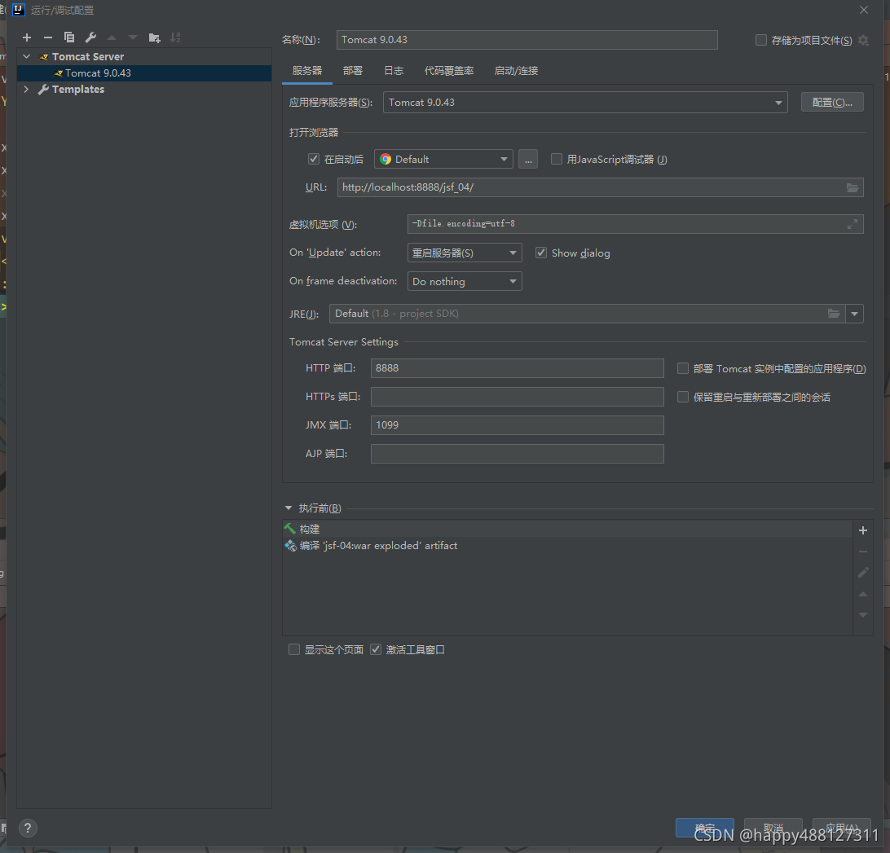

<a id="section-14"></a>

##  7、在web.xml中配置 默认启动页

```xml
<?xml version="1.0" encoding="UTF-8"?>
<web-app xmlns="http://xmlns.jcp.org/xml/ns/javaee"
         xmlns:xsi="http://www.w3.org/2001/XMLSchema-instance"
         xsi:schemaLocation="http://xmlns.jcp.org/xml/ns/javaee http://xmlns.jcp.org/xml/ns/javaee/web-app_4_0.xsd"
         version="4.0">
    <welcome-file-list>
        <welcome-file>index.xhtml</welcome-file>
    </welcome-file-list>
    <servlet>
        <servlet-name>Faces Servlet</servlet-name>
        <servlet-class>javax.faces.webapp.FacesServlet</servlet-class>
        <load-on-startup>1</load-on-startup>
    </servlet>
    <servlet-mapping>
        <servlet-name>Faces Servlet</servlet-name>
        <url-pattern>*.xhtml</url-pattern>
    </servlet-mapping>
</web-app>
```

<a id="section-15"></a>

## 8、直接启动tomcat服务器，部署完成


<a id="section-16"></a>

# 附加：在tomcat上部署从maven骨架创建的jsf项目

点击项目结构，点击构件，在对应模块的WEB-INF目录下手动创建一个lib，在其中添加上方提到的两个jar包即可

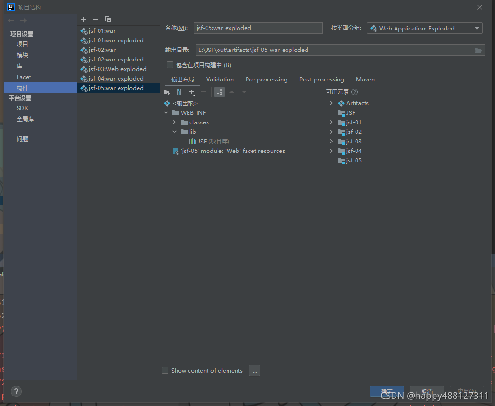
