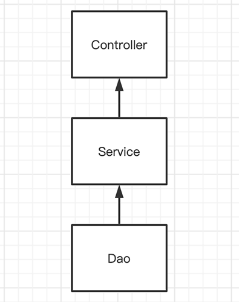
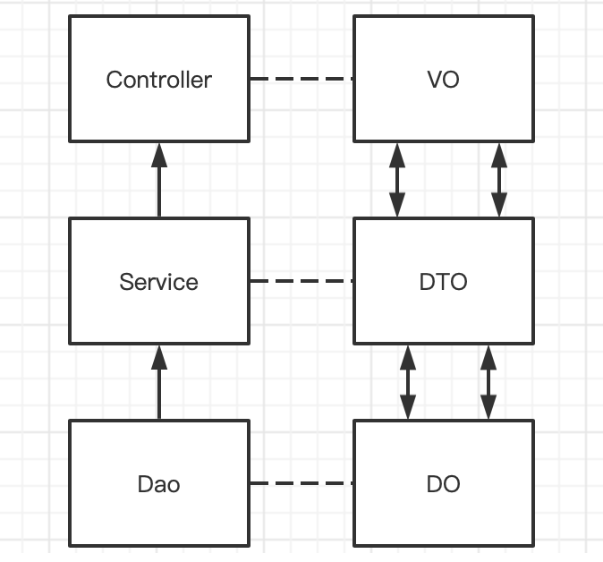

# MVC 与 Java Web 分层

区分 MVC、三层架构和常见数据对象，开发时确定职责与依赖方向。

**学习前提与版本：** 需要 Java 类、接口与基本 HTTP 知识。这里讲设计职责，不要求每个项目使用同样的目录或类名。

**截图说明：** 图片保留原教学环境的操作过程；若截图中的旧写法与正文不同，以修订后的正文和所选版本的官方文档为准。

**示例使用：** 除明确列出全部文件和运行步骤的项目外，代码块是各小节的独立片段。省略号、占位名称需要补齐；标明错误的行用于说明问题。同节替代写法不要合并。

[学习索引与常见词](README.md) · [官方参考](https://docs.spring.io/spring-framework/reference/web/webmvc.html)

**内容导航**

- [MVC 的三个职责](#section-1)
- [MVC 与三层架构](#section-2)
- [常见对象名称](#section-3)
- [数据如何在各层之间传递](#section-4)
- [项目目录示例](#section-5)
- [服务与接口的边界](#section-6)


<a id="section-1"></a>

## MVC 的三个职责

MVC 是 Model（模型）、View（视图）、Controller（控制器）的缩写。

| 部分 | 职责 | 常见例子 |
| --- | --- | --- |
| Model | 表达业务数据与业务处理能力 | 用户对象、订单服务 |
| View | 展示数据，提供交互界面 | HTML、Thymeleaf 模板、Vue 页面 |
| Controller | 接收请求，调用业务，组织响应 | Spring MVC 控制器 |

**Mapper 不是 MVC 中的 M，Controller 也不是 View。** MVC 是职责划分方式，不是三个固定的 Java 包。

<a id="section-2"></a>

## MVC 与三层架构

Java Web 常把后端分成表现层、业务层和数据访问层。MVC 描述视图、控制器与模型如何协作，不能简单与三层架构一一对应。

```text
Browser -> Controller -> Service -> DAO / Mapper -> Database
Browser <- Controller <- Service <- DAO / Mapper <- Database
```

- Controller：接收路径、参数和请求体，校验输入，调用 Service，返回页面或数据。
- Service：实现业务规则，组织事务。例如下单同时涉及库存和订单。
- DAO / Mapper：访问数据库，例如查询用户、更新库存。

依赖通常从上层指向下层：Controller 依赖 Service，Service 依赖 DAO。下层不应反过来调用上层。上层可以依赖接口，通过注入获得实现。



<a id="section-3"></a>

## 常见对象名称

| 名称 | 含义 | 用法 |
| --- | --- | --- |
| POJO | Plain Old Java Object，普通 Java 对象 | 不依赖特定框架才能使用；不要求必须有 getter/setter，也不排斥持久化用途 |
| Entity / PO / DO | 表达持久化数据的对象 | 经常与表字段对应，但不是所有系统都要求“一类一表” |
| DTO | Data Transfer Object，数据传输对象 | 在接口或层之间传数据，只包含调用方需要的字段 |
| VO | View Object，视图对象 | 按页面或 API 响应需要组织字段 |
| DAO | Data Access Object，数据访问对象 | 封装访问数据库的方法 |
| Domain | 领域模型 | 表达业务概念和规则，不只是多个表拼成的大对象 |

这些名称存在团队约定差异。先约定用途，再统一命名。例如，数据库用户包含密码哈希，而用户列表只需要编号和昵称；返回 UserView 可以避免把敏感字段暴露给前端。

<a id="section-4"></a>

## 数据如何在各层之间传递

```text
JSON request -> CreateUserRequest -> Service -> UserEntity -> Database
JSON response <- UserView <- Service <- UserEntity <- Database
```

简单查询可以直接返回 DTO。复杂业务可以引入领域对象。是否增加 VO、DTO、DO 应根据职责决定，不必每次请求都创建六种对象和四次转换。



<a id="section-5"></a>

## 项目目录示例

```text
src/main/java/com/example/app/
  controller/
  service/
  repository/
  entity/
  dto/
  config/
src/main/resources/
  mapper/
  static/
  templates/
```

Java 包名使用小写。repository 存放 DAO 或 Mapper 接口，mapper 资源目录存放 SQL 映射文件。

Spring Boot 的 static 存放静态资源，templates 存放模板引擎的模板。引入 Thymeleaf 不会自动覆盖全部静态页面。JSP 的部署方式不同，不能直接放进 templates 就期待它被解析。

<a id="section-6"></a>

## 服务与接口的边界

Controller 应简洁，但不仅负责校验和转换，还要处理 HTTP 状态码、响应头等表现层工作。

Service 负责业务。不要求每张表都有完整 CRUD，也不要求所有 Service 都创建 ServiceImpl；存在实现替换、测试边界或团队约定时再引入接口。

复杂业务可以拆成多个服务，通过构造器注入协作。不要通过 getXXXService().getRepository() 逐层暴露内部结构。

| 操作 | 方法名示例 | 需要约定的行为 |
| --- | --- | --- |
| 创建 | createUser(request) | 校验、重复数据处理 |
| 更新 | updateUser(id, request) | 目标不存在时怎么办 |
| 查询一个 | findUserById(id) | 返回 Optional、null 或抛出异常 |
| 查询列表 | listUsers(query) | 过滤、排序和分页 |
| 删除 | deleteUser(id) | 目标不存在时是否报错 |

DDD 的“聚合”是维护业务一致性边界的模型，不是“一个 Service 持有很多子 Service”的同义词。
