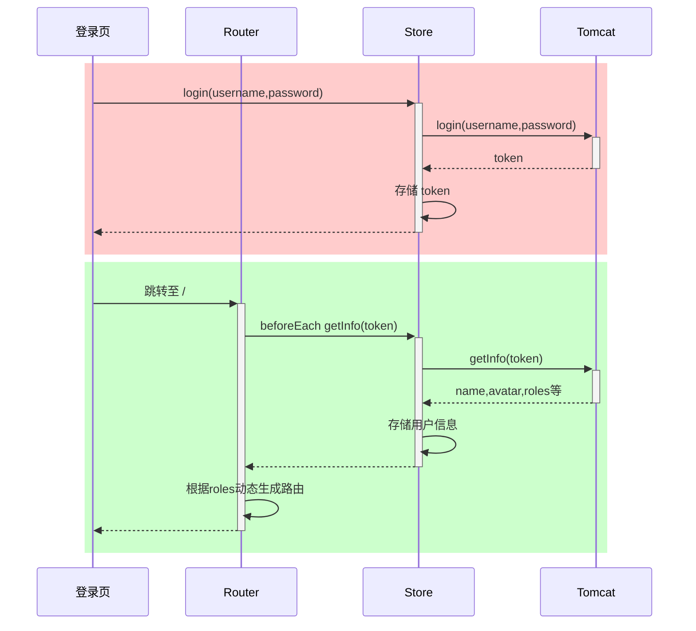
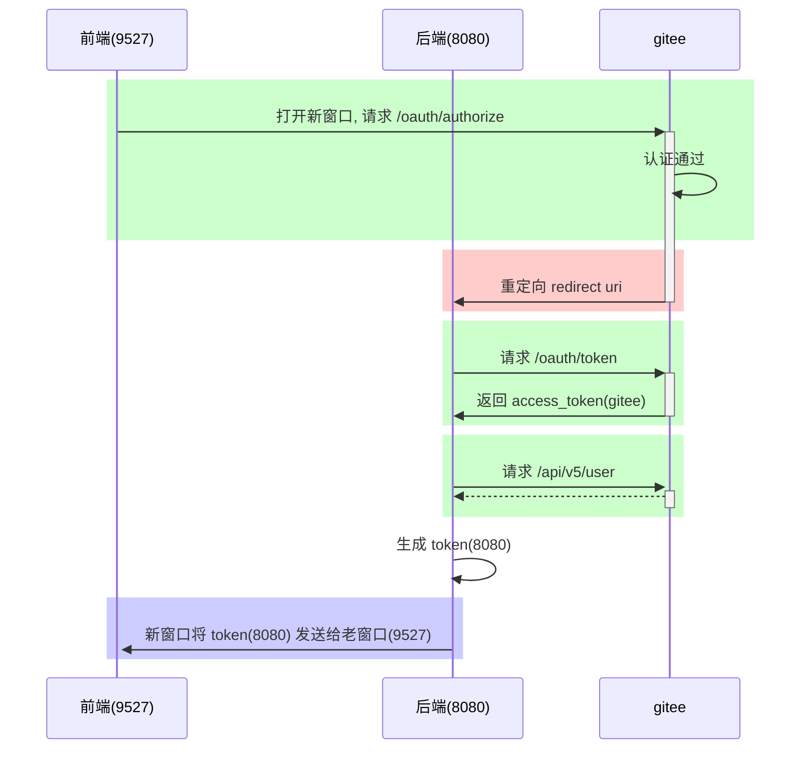

# III. Vue 2 :id=h-b2b9d95fb753

Practice components, requests, dynamic routes, Vuex, and administration interfaces in a Vue 2 project.

**Prerequisites and versions:** This historical setup uses Vue 2, Vue Router 3, Vuex 3, and Element UI 2. Check the project lockfile and Node version first; Vue 2 has reached end of official support. Start the sample backend separately; mock data is not a real service.

**About screenshots:** Images retain the steps from the original teaching environment. If older code in a screenshot differs from the text, follow the revised text and the official documentation for your selected version.

**Using the examples:** Unless a project explicitly lists all files and run instructions, code blocks are independent snippets for each section. Fill in ellipses and placeholder names; lines marked as incorrect illustrate problems. Do not combine alternative implementations from the same section.

[Documentation index](README.md) · [Official references](https://v2.vuejs.org/v2/guide/)

**Contents**

- [1. Vue basics](#section-1)
- [2. Advanced Vue](#section-2)
- [3. Vue in practice](#section-3)

<a id="section-1"></a>

## 1. Vue basics :id=h-0990ab49a08b

### 1) Environment setup :id=h-7b44d6166c7a

#### Install the scaffolding tool :id=h-7365048a1fde

```
npm install -g @vue/cli
```

- -g installs globally, allowing the vue script to create projects from any directory.

#### Create a project :id=h-17b5ddebaefa

```cmd
vue ui
```

Use the graphical wizard to create a Vue project. Enter the project name as shown below.


Select manual project configuration


Add Vue Router and Vuex


Select a version and create the project


#### Install devtools :id=h-d7fcb8e798bd

- devtools extension: [https://devtools.vuejs.org/guide/installation.html](https://devtools.vuejs.org/guide/installation.html)


#### Run the project :id=h-9cc11e94f911

Enter the project directory and run:

```cmd
npm run serve
```

#### Change the port :id=h-6144b711a51b

The frontend server uses port 8080 by default; change it.

- Documentation: [DevServer | webpack](https://webpack.js.org/configuration/dev-server/#devserverport)

- Open vue.config.js and add:

  ```js
  const { defineConfig } = require('@vue/cli-service')
  module.exports = defineConfig({

    // ...

    devServer: {
      port: 7070
    }

  })
  ```

#### Add a proxy :id=h-73d536ab8a6d

Configure a proxy to avoid cross-origin issues with fetch and XHR when testing frontend and backend servers together.

- Use the documentation link above

- Open vue.config.js and add:

  ```js
  const { defineConfig } = require('@vue/cli-service')
  module.exports = defineConfig({

    // ...

    devServer: {
      port: 7070,
      proxy: {
        '/api': {
          target: 'http://localhost:8080',
          changeOrigin: true
        }
      }
    }

  })
  ```

#### Vue project structure :id=h-95ef4ac94498

```
PS 代码\第3章\client> tree src
代码\第3章\CLIENT\SRC
├─assets
├─components
├─router
├─store
└─views
```

- assets: static resources
- components: reusable components
- router: routing
- store: shared data
- views: view components

We will later add:

- api: communicates with the backend, sends fetch/XHR requests, and receives responses
- plugins: plugins

### 2) Vue components :id=h-f4aac9cf8faa

Vue component files end in .vue, with three sections:

```vue
<template></template>

<script></script>

<style></style>
```

- template: the template that generates HTML
- script: code controlling the template's data sources and behavior
- style: styles, which we generally pay little attention to here

The entry component is App.vue.

Delete the existing code and start with Hello, World.

```vue
<template>
  <h1>{{msg}}</h1>
</template>

<script>
export default {
  data() {
    return {
      msg: "Hello, Vue!"
    }
  }
}
</script>
```

Explanation

- export default exports the component object for main.js to import.
- This object has a data method returning an **object** that provides data to template.
- In Vue, `{{}}` is an interpolation expression that **binds** properties of the **object** returned by data. **Binding** means the page display updates along with data changes.

#### Text interpolation :id=h-2d6dfa4aa2c2

```vue
<template>
    <div>
        <h1>{{ name }}</h1>
        <h1>{{ age > 60 ? '老年' : '青年' }}</h1>
    </div>
</template>
<script>
const options = {
    data: function () {
        return { name: '张三', age: 70 };
    }
};
export default options;
</script>
```

- Write one JavaScript expression in each interpolation. It can use multiple properties, such as {{ firstName + ' ' + lastName }}. Statements such as if cannot be used inside interpolation.
- template can contain only one root element
- Simple expressions can be evaluated in interpolation

#### Attribute binding :id=h-5b6bbcba2ce0

```vue
<template>
    <div>
        <div><input type="text" v-bind:value="name"></div>
        <div><input type="date" v-bind:value="birthday"></div>
        <div><input type="text" :value="age"></div>
    </div>
</template>
<script>
const options = {
    data: function () {
        return { name: '王五', birthday: '1995-05-01', age: 20 };
    }
};
export default options;
</script>
```

- Shorthand: omit v-bind and keep only the colon

#### Event binding :id=h-72c7b65bf501

```vue
<!-- See note 1 below. -->
<template>
    <div>
        <div><input type="button" value="点我执行m1" v-on:click="m1"></div>
        <div><input type="button" value="点我执行m2" @click="m2"></div>
        <div>{{count}}</div>
    </div>
</template>
<script>
const options = {
    data: function () {
        return { count: 0 };
    },
    methods: {
        m1() {
            this.count ++;
            console.log("m1")
        },
        m2() {
            this.count --;
            console.log("m2")
        }
    }
};
export default options;
</script>
```

Example explanations:

1. Event binding

- Shorthand: replace v-on: with @
- In ordinary methods, this is the component instance. Vue proxies data properties onto the instance, allowing this.name. Arrow functions do not receive this binding.

#### Two-way binding :id=h-219bb5901d9b

```vue
<template>
    <div>
        <div>
            <label for="">请输入姓名</label>
            <input type="text" v-model="name">
        </div>
        <div>
            <label for="">请输入年龄</label>
            <input type="text" v-model="age">
        </div>
        <div>
            <label for="">请选择性别</label>
            男 <input type="radio" value="男" v-model="sex">
            女 <input type="radio" value="女" v-model="sex">
        </div>
        <div>
            <label for="">请选择爱好</label>
            游泳 <input type="checkbox" value="游泳" v-model="fav">
            打球 <input type="checkbox" value="打球" v-model="fav">
            健身 <input type="checkbox" value="健身" v-model="fav">
        </div>
    </div>
</template>
<script>
const options = {
    data: function () {
        return { name: '', age: null, sex:'男' , fav:['打球']};
    },
    methods: {
    }
};
export default options;
</script>
```

- v-model provides two-way binding:
  - JavaScript data is synchronized to the form control
  - Conversely, new user input in the form control is synchronized back to JavaScript
- Two-way binding is suited to input-capable controls such as forms; one-way data binding suffices for other elements.
- For checkboxes, the bound JavaScript data is generally an array.

#### Computed properties :id=h-cec2ac5e6bda

```vue
<!-- See note 1 below. -->
<template>
    <div>
        <h2>{{fullName}}</h2>
        <h2>{{fullName}}</h2>
        <h2>{{fullName}}</h2>
    </div>
</template>
<script>
const options = {
    data: function () {
        return { firstName: '三', lastName: '张' };
    },
    /* See note 2 below. */
    computed: {
        fullName() {
            console.log('进入了 fullName')
            return this.lastName + this.firstName;
        }
    }
};
export default options;
```

Example explanations:

1. Computed properties
2. methods: {; fullName() {; console.log('Entered fullName'); return this.lastName + this.firstName; } },

- Ordinary method calls require () and do not cache results.
- Use a computed property like a property, without (). It caches results:
  - After calculation, the result is cached. As long as the data has not changed, the next access returns the cached result without recalculating.

#### axios :id=h-6da2f317b6b5

Axios uses XMLHttpRequest (XHR) underneath to send requests and receive responses. XHR offers more features than the Fetch API discussed earlier, but as an older API it does not support Promises. Axios wraps XHR with Promise support and unified request/response interceptors.

Installation

```cmd
npm install axios -S
```

Import

```js
import axios from 'axios'
```

- Axios's default export is a callable Axios instance, also providing methods such as get and post.

Method

| Requests                             | Notes  |
| ------------------------------------ | ------ |
| axios.get(url\[, config])            | :star: |
| axios.delete(url\[, config])         |        |
| axios.head(url\[, config])           |        |
| axios.options(url\[, config])        |        |
| axios.post(url\[, data\[, config]])  | :star: |
| axios.put(url\[, data\[, config]])   |        |
| axios.patch(url\[, data\[, config]]) |        |

- config: options object, such as query parameters and request headers
- data: request body data, most commonly JSON
- GET and HEAD cannot carry a body here due to browser restrictions, applying to both XHR and Fetch APIs.
- OPTIONS and DELETE can carry a body through data in config.

Example

```vue
<template>
    <div>
        <input type="button" value="获取远程数据" @click="sendReq()">
    </div>
</template>
<script>
import axios from 'axios'
const options = {
    methods: {
        async sendReq() {
            // See note 1 below.
            // const resp = await axios.post('/api/a2');

            // See note 2 below.
            // const resp = await axios.post('/api/a3',{},{
            //     headers:{
            //         Authorization:'abc'
            //     }
            // });

            // See note 3 below.
            // const name = encodeURIComponent('&&&');
            // const age = 18;
            // const resp = await axios.post(`/api/a4?name=${name}&age=${age}`);

            // See note 4 below.
            // const resp = await axios.post('/api/a4', {}, {
            //     params: {
            //         name:'&&&&',
            //         age: 20
            //     }
            // });

            // See note 5 below.
            // const params = new URLSearchParams();
            // See note 6 below.
            // params.append("age", 24)

            // const resp = await axios.post('/api/a4', params);

            // See note 7 below.
            // const params = new FormData();
            // See note 8 below.
            // params.append("age", 30);
            // const resp = await axios.post('/api/a5', params);

            // See note 9 below.
            const resp = await axios.post('/api/a5json', {
                name: '王五',
                age: 50
            });

            console.log(resp);
        }
    }
};
export default options;
</script>
```

Example explanations:

1. 1. Demonstrate GET and POST
2. 2. Send request headers
3. 3. Include query parameters ?name=xxx\&age=xxx in a request
4. To avoid constructing strings and handling special characters yourself, use the following method.
5. 4. Send URL-encoded data in the request body
6. params.append("name", "Zhang San");
7. 5. Send multipart data in the request body
8. params.append("name", "Li Si");
9. 6. Send JSON data in the request body

Create an instance

```js
const _axios = axios.create(config);
```

- The axios object can be used directly with default settings.
- Objects created with axios.create can override default settings. See config below.

Common config options include:

| Name            | Meaning                                                                         |
| --------------- | ------------------------------------------------------------------------------- |
| baseURL         | Automatically prepended to the URL                                              |
| headers         | Request headers, as a plain object                                              |
| params          | Request parameters following the URL, as a plain object or URLSearchParams      |
| data            | Request body, as a plain object, FormData, URLSearchParams, File, and so on     |
| withCredentials | Whether to include credentials such as Cookies across origins; false by default |
| responseType    | Response type; JSON by default                                                  |

Example

```js
const _axios = axios.create({
    baseURL: 'http://localhost:8080',
    withCredentials: true
});
await _axios.post('/api/a6set')
await _axios.post('/api/a6get')
```

- To bypass the proxy for XHR in production, change baseURL centrally.
- To include Cookies across origins, set withCredentials: true and configure allowCredentials = true on the server. Otherwise, the browser reports an error when receiving cross-origin Cookies.

Response format

| Name    | Meaning                   |
| ------- | ------------------------- |
| data    | Response body data :star: |
| status  | Status code :star:        |
| headers | Response headers          |

- 200: successful response
- 400: incorrect request data, such as age=abc
- 401: authentication failed
- 403: permission denied
- 404: resource not found
- 405: request method, such as POST, is unsupported
- 500: internal server error

Request interceptor

```js
_axios.interceptors.request.use(
  function(config) {
    // See note 1 below.
    return config;
  },
  function(error) {
    return Promise.reject(error);
  }
);
```

Example explanations:

1. For example, add common headers here

Response interceptor

```js
_axios.interceptors.response.use(
  function(response) {
    // See note 1 below.
    return response;
  },
  function(error) {
    // See note 2 below.
    return Promise.reject(error);
  }
);
```

Example explanations:

1. Statuses in the 2xx range go here
2. Statuses outside 2xx, such as 4xx and 5xx, go here

#### Conditional rendering :id=h-aee2280f5942

```vue
<template>
    <div>
        <input type="button" value="获取远程数据" @click="sendReq()">
        <div class="title">学生列表</div>
        <div class="thead">
            <div class="row bold">
                <div class="col">编号</div>
                <div class="col">姓名</div>
                <div class="col">性别</div>
                <div class="col">年龄</div>
            </div>
        </div>
        <div class="tbody">
            <div class="row" v-if="students.length > 0">显示学生数据</div>
            <div class="row" v-else>暂无学生数据</div>
        </div>
    </div>
</template>
<script>
import axios from '../util/myaxios'
const options = {
    data: function() {
        return {
            students: []
        };
    },
    methods : {
        async sendReq() {
            const resp = await axios.get("/api/students");
            console.log(resp.data.data)
            this.students = resp.data.data;
        }
    }
};
export default options;
</script>
<style scoped>
    div {
        font-family: 华文行楷;
        font-size: 20px;
    }

    .title {
        margin-bottom: 10px;
        font-size: 30px;
        color: #333;
        text-align: center;
    }

    .row {
        background-color: #fff;
        display: flex;
        justify-content: center;
    }

    .col {
        border: 1px solid #f0f0f0;
        width: 15%;
        height: 35px;
        text-align: center;
        line-height: 35px;
    }

    .bold .col {
        background-color: #f1f1f1;
    }
</style>
```

#### List rendering :id=h-569079d161a6

```vue
<template>
    <div>
        <!-- See note 1 below. -->
        <div class="title">学生列表</div>
        <div class="thead">
            <div class="row bold">
                <div class="col">编号</div>
                <div class="col">姓名</div>
                <div class="col">性别</div>
                <div class="col">年龄</div>
            </div>
        </div>
        <div class="tbody">
            <div v-if="students.length > 0">
                <div class="row" v-for="s of students" :key="s.id">
                    <div class="col">{{s.id}}</div>
                    <div class="col">{{s.name}}</div>
                    <div class="col">{{s.sex}}</div>
                    <div class="col">{{s.age}}</div>
                </div>
            </div>
            <div class="row" v-else>暂无学生数据</div>
        </div>
    </div>
</template>
<script>
import axios from '../util/myaxios'
const options = {
    mounted: function(){
        this.sendReq()
    },
    data: function() {
        return {
            students: []
        };
    },
    methods : {
        async sendReq() {
            const resp = await axios.get("/api/students");
            console.log(resp.data.data)
            this.students = resp.data.data;
        }
    }
};
export default options;
</script>
<style scoped>
    div {
        font-family: 华文行楷;
        font-size: 20px;
    }

    .title {
        margin-bottom: 10px;
        font-size: 30px;
        color: #333;
        text-align: center;
    }

    .row {
        background-color: #fff;
        display: flex;
        justify-content: center;
    }

    .col {
        border: 1px solid #f0f0f0;
        width: 15%;
        height: 35px;
        text-align: center;
        line-height: 35px;
    }

    .bold .col {
        background-color: #f1f1f1;
    }
</style>
```

Example explanations:

1. \<input type="button" value="Get remote data" @click="sendReq()">

- Avoid v-if and v-for on the same element. In Vue 2, v-for takes precedence; in Vue 3, v-if does. An outer template or a computed property that filters the list first is clearer.
- Use v-for with the special key attribute, bound to uniquely identifying data. This example uses the student ID.
- The mounted option is a function called after the component mounts and is ready. Send a request there to get student data.

#### Reusing components :id=h-4f701fe6c9da

Button component

```vue
<template>
    <div class="button" :class="[type,size]">
        a<slot></slot>b
    </div>
</template>
<script>
const options = {
    props: ["type", "size"]
};
export default options;
</script>
```

- The style section is omitted.

Using components

```vue
<template>
    <div>
        <h1>父组件</h1>
        <my-button type="primary" size="small">1</my-button>
        <my-button type="danger" size="middle">2</my-button>
        <my-button type="success" size="large">3</my-button>
    </div>
</template>
<script>
import MyButton from '../components/MyButton.vue'
const options = {
    components: {
        MyButton
    }
};
export default options;
</script>
```

<a id="section-2"></a>

## 2. Advanced Vue :id=h-5a79d7f8c429

### 1) ElementUI :id=h-d35fa8c7c5c3

Installation

```cmd
npm install element-ui -S
```

Import components

```js
import Element from 'element-ui'
import 'element-ui/lib/theme-chalk/index.css'

Vue.use(Element)
```

Test by using ElementUI components inside your own component.

```vue
<el-button>按钮</el-button>
```

#### Table component :id=h-04abd92104b0

```vue
<template>
    <div>
        <el-table :data="students">
            <el-table-column label="编号" prop="id"></el-table-column>
            <el-table-column label="姓名" prop="name"></el-table-column>
            <el-table-column label="性别" prop="sex"></el-table-column>
            <el-table-column label="年龄" prop="age"></el-table-column>
        </el-table>
    </div>
</template>
<script>
import axios from '../util/myaxios'
const options = {
    async mounted() {
        const resp = await axios.get('/api/students');
        this.students = resp.data.data
    },
    data() {
        return {
            students: []
        }
    }
}
export default options;
</script>
```

#### Pagination component :id=h-f57c3b805210

```vue
<template>
    <div>
        <el-table v-bind:data="students">
            <el-table-column label="编号" prop="id"></el-table-column>
            <el-table-column label="姓名" prop="name"></el-table-column>
            <el-table-column label="性别" prop="sex"></el-table-column>
            <el-table-column label="年龄" prop="age"></el-table-column>
        </el-table>
        <el-pagination
            :total="total"
            :page-size="queryDto.size"
            :current-page="queryDto.page"
            layout="prev,pager,next,sizes,->,total"
            :page-sizes="[5,10,15,20]"
            @current-change="currentChange"
            @size-change="sizeChange"
        ></el-pagination>
    </div>
</template>
<script>
import axios from '../util/myaxios'
const options = {
    mounted() {
        this.query();
    },
    methods: {
        currentChange(page) {
            this.queryDto.page = page;
            this.query();
        },
        sizeChange(size){
            this.queryDto.size = size;
            this.query();
        },
        async query() {
            const resp = await axios.get('/api/students/q', {
                params: this.queryDto
            });
            this.students = resp.data.data.list;
            this.total = resp.data.data.total;
        }
    },
    data() {
        return {
            students: [],
            total: 0,
            queryDto: {
                page: 1,
                size: 5
            }
        }
    }
}
export default options;
</script>
```

- All three situations should trigger a query:
  - After mounting, in mounted
  - When the page number changes
  - When the page size changes
- Choose a query parameter-passing method flexibly according to backend requirements.
  - This example uses GET, so it cannot use a request body; pass parameters through params.
- Responses may have complex structures. Learn to extract data according to the actual returned structure.

#### Paginated search :id=h-1e33374c02fc

```vue
<template>
    <div>
        <el-input placeholder="请输入姓名" size="mini" v-model="queryDto.name"></el-input>
        <el-select placeholder="请选择性别" size="mini" v-model="queryDto.sex" clearable>
            <el-option value="男"></el-option>
            <el-option value="女"></el-option>
        </el-select>
        <el-select placeholder="请选择年龄" size="mini" v-model="queryDto.age" clearable>
            <el-option value="0,20" label="0到20岁"></el-option>
            <el-option value="21,30" label="21到30岁"></el-option>
            <el-option value="31,40" label="31到40岁"></el-option>
            <el-option value="41,120" label="41到120岁"></el-option>
        </el-select>
        <el-button type="primary" size="mini" @click="search()">搜索</el-button>
        <el-divider></el-divider>
        <el-table v-bind:data="students">
            <el-table-column label="编号" prop="id"></el-table-column>
            <el-table-column label="姓名" prop="name"></el-table-column>
            <el-table-column label="性别" prop="sex"></el-table-column>
            <el-table-column label="年龄" prop="age"></el-table-column>
        </el-table>
        <el-pagination :total="total" :page-size="queryDto.size" :current-page="queryDto.page"
            layout="prev,pager,next,sizes,->,total" :page-sizes="[5, 10, 15, 20]" @current-change="currentChange"
            @size-change="sizeChange"></el-pagination>
    </div>
</template>
<script>
import axios from '../util/myaxios'
const options = {
    mounted() {
        this.query();
    },
    methods: {
        currentChange(page) {
            this.queryDto.page = page;
            this.query();
        },
        sizeChange(size) {
            this.queryDto.size = size;
            this.query();
        },
        async query() {
            const resp = await axios.get('/api/students/q', {
                params: this.queryDto
            });
            this.students = resp.data.data.list;
            this.total = resp.data.data.total;
        },
        search() {
            this.query();
        }
    },
    data() {
        return {
            students: [],
            total: 0,
            queryDto: {
                name: '',
                sex: '',
                age: '',
                page: 1,
                size: 5
            }
        }
    }
}
export default options;
</script>
```

- For sex and age, `''` indicates no user selection.
- Spring converts age=`0,20` to `new int[]{0, 20}`.
- Spring converts age=`''` to `new int[0]`.

#### Cascading selection :id=h-efbae49ca1e2

The cascading selector's option data structure is:

```js
[
    {value:100, label:'主页',children:[
        {value:101, label:'菜单1', children:[
            {value:105, label:'子项1'},
            {value:106, label:'子项2'}
        ]},
        {value:102, label:'菜单2', children:[
            {value:107, label:'子项3'},
            {value:108, label:'子项4'},
            {value:109, label:'子项5'}
        ]},
        {value:103, label:'菜单3', children:[
            {value:110, label:'子项6'},
            {value:111, label:'子项7'}
        ]},
        {value:104, label:'菜单4'}
    ]}
]
```

The following example turns the backend's flat array into a tree.

```vue
<template>
    <el-cascader :options="ops"></el-cascader>
</template>
<script>
import axios from '../util/myaxios'
const options = {
    async mounted() {
        const resp = await axios.get('/api/menu')
        console.log(resp.data.data)
        const array = resp.data.data;

        const map = new Map();

        // See note 1 below.
        for(const {id,name,pid} of array) {
            map.set(id, {value:id, label:name, pid:pid})
        }
        // See note 2 below.
        // See note 3 below.
        const top = [];
        for(const obj of map.values()) {
            const parent = map.get(obj.pid);
            if(parent !== undefined) {
                parent.children ??= [];
                parent.children.push(obj);
            } else {
                top.push(obj)
            }
        }
        this.ops = top;
    },
    data(){
        return {
            ops: []
        }
    }
};
export default options;
</script>
```

Example explanations:

1. 1. Store all data in a map for efficient lookup later
2. 2. Establish parent-child relationships
3. 3. Find top-level objects

### 2) Vue-Router :id=h-505809108377

A Vue application is a single-page application. Routing replaces the page's displayed content with different **view components** according to the browser path.

#### Configure routes :id=h-1bf98f0b352b

Create a routing JavaScript file, such as src/router/example14.js, with the following contents:

```js
import Vue from 'vue'
import VueRouter from 'vue-router'
import ContainerView from '@/views/example14/ContainerView.vue'
import LoginView from '@/views/example14/LoginView.vue'
import NotFoundView from '@/views/example14/NotFoundView.vue'

Vue.use(VueRouter)

const routes = [
  {
    path:'/',
    component: ContainerView
  },
  {
    path:'/login',
    component: LoginView
  },
  {
    path:'/404',
    component: NotFoundView
  }
]

const router = new VueRouter({
  routes
})

export default router
```

- The key is mapping paths to view components.
- This example maps three paths to their view components.

Use our routing file in main.js.

```js
import Vue from 'vue'
import e14 from './views/Example14View.vue'
import router from './router/example14'  // See note 1 below.
import store from './store'
import Element from 'element-ui'
import 'element-ui/lib/theme-chalk/index.css'

Vue.config.productionTip = false

Vue.use(Element)
new Vue({
  router,
  store,
  render: h => h(e14)
}).$mount('#app')
```

Example explanations:

1. Change this part

The root component is Example14View\.vue, containing:

```vue
<template>
    <div class="all">
        <router-view></router-view>
    </div>
</template>
```

- Styles omitted
- `<router-view>` is a placeholder. When the path changes, the matching view component occupies `<router-view>`, replacing its previous content.

#### Dynamic imports :id=h-b6d3f215fdb3

```js
import Vue from 'vue'
import VueRouter from 'vue-router'

Vue.use(VueRouter)

const routes = [
  {
    path:'/',
    component: () => import('@/views/example14/ContainerView.vue')
  },
  {
    path:'/login',
    component: () => import('@/views/example14/LoginView.vue')
  },
  {
    path:'/404',
    component: () => import('@/views/example14/NotFoundView.vue')
  }
]

const router = new VueRouter({
  routes
})

export default router
```

- Static imports bundle all component JavaScript together. With many components, the bundle grows large and slows page loading.
- Dynamic imports put component JavaScript in separate files loaded only when needed.

#### Nested routes :id=h-92b2ace80c19

To switch content inside a component, use nested (child) routes. This example defines three child routes inside ContainerView.

```js
const routes = [
  {
    path:'/',
    component: () => import('@/views/example14/ContainerView.vue'),
    redirect: '/c/p1',
    children: [
      {
        path:'c/p1',
        component: () => import('@/views/example14/container/P1View.vue')
      },
      {
        path:'c/p2',
        component: () => import('@/views/example14/container/P2View.vue')
      },
      {
        path:'c/p3',
        component: () => import('@/views/example14/container/P3View.vue')
      }
    ]
  },
  {
    path:'/login',
    component: () => import('@/views/example14/LoginView.vue')
  },
  {
    path:'/404',
    component: () => import('@/views/example14/NotFoundView.vue')
  },
  {
    path:'*',
    redirect: '/404'
  }
]
```

Changing a child route switches the `<router-view></router-view>` content inside ContainerView.

```vue
<template>
    <div class="container">
        <router-view></router-view>
    </div>
</template>
```

- redirect redirects navigation to a new address.
- path=\* matches when no other path matches.

#### ElementUI layout :id=h-535f892b4b5c

Home pages usually need a layout. The code below uses ElementUI's top section with left/right sections below.

```vue
<template>
    <div class="container">
        <el-container>
            <el-header></el-header>
            <el-container>
                <el-aside width="200px"></el-aside>
                <el-main>
                    <router-view></router-view>
                </el-main>
            </el-container>
        </el-container>
    </div>
</template>
```

#### Route navigation :id=h-6567e435972a

##### Declarative, using elements :id=h-52759389efb1

```vue
<el-aside width="200px">
    <router-link to="/c1/p1">P1</router-link>
    <router-link to="/c1/p2">P2</router-link>
    <router-link to="/c1/p3">P3</router-link>
</el-aside>
```

##### Programmatic :id=h-a9a1d67e7d6d

```vue
<el-header>
    <el-button type="primary" icon="el-icon-edit"
               circle size="mini" @click="jump('/c1/p1')"></el-button>
    <el-button type="success" icon="el-icon-check"
               circle size="mini" @click="jump('/c1/p2')"></el-button>
    <el-button type="warning" icon="el-icon-star-off"
               circle size="mini" @click="jump('/c1/p3')"></el-button>
</el-header>
```

jump method

```vue
<script>
const options = {
    methods : {
        jump(url) {
            this.$router.push(url);
        }
    }
}
export default options;
</script>
```

- this.$router gets the router object.
- push navigates to a URL.

##### Navigation menu :id=h-d9b22ff5df40

```vue
<el-menu router background-color="#545c64" text-color="#fff" active-text-color="#ffd04b">
    <el-submenu index="/c1">
        <span slot="title">
            <i class="el-icon-platform-eleme"></i>
            菜单1
        </span>
        <el-menu-item index="/c1/p1">子项1</el-menu-item>
        <el-menu-item index="/c1/p2">子项2</el-menu-item>
        <el-menu-item index="/c1/p3">子项3</el-menu-item>
    </el-submenu>
    <el-menu-item index="/c2">
        <span slot="title">
            <i class="el-icon-phone"></i>
            菜单2
        </span>
    </el-menu-item>
    <el-menu-item index="/c3">
        <span slot="title">
            <i class="el-icon-star-on"></i>
            菜单3
        </span>
    </el-menu-item>
</el-menu>
```

- Wrap icons and menu item text in `<span slot='title'></span>`.
- Adding `router` to `el-menu` connects the menu to the router, allowing navigation through each menu item's `index`.

#### Dynamic routes and menus :id=h-2497cfc61b26

Store menu and route information for the home page in the database.

```sql
insert into menu(id, name, pid, path, component, icon) values
    (101, '菜单1', 0,   '/m1',    null,         'el-icon-platform-eleme'),
    (102, '菜单2', 0,   '/m2',    null,         'el-icon-delete-solid'),
    (103, '菜单3', 0,   '/m3',    null,         'el-icon-s-tools'),
    (104, '菜单4', 0,   '/m4',    'M4View.vue', 'el-icon-user-solid'),
    (105, '子项1', 101, '/m1/c1', 'C1View.vue', 'el-icon-s-goods'),
    (106, '子项2', 101, '/m1/c2', 'C2View.vue', 'el-icon-menu'),
    (107, '子项3', 102, '/m2/c3', 'C3View.vue', 'el-icon-s-marketing'),
    (108, '子项4', 102, '/m2/c4', 'C4View.vue', 'el-icon-s-platform'),
    (109, '子项5', 102, '/m2/c5', 'C5View.vue', 'el-icon-picture'),
    (110, '子项6', 103, '/m3/c6', 'C6View.vue', 'el-icon-upload'),
    (111, '子项7', 103, '/m3/c7', 'C7View.vue', 'el-icon-s-promotion');
```

Different users receive different menu and route information.

For example, accessing `/api/menu/admin` returns all data.

```json
[
    {
        "id": 102,
        "name": "菜单2",
        "icon": "el-icon-delete-solid",
        "path": "/m2",
        "pid": 0,
        "component": null
    },
    {
        "id": 107,
        "name": "子项3",
        "icon": "el-icon-s-marketing",
        "path": "/m2/c3",
        "pid": 102,
        "component": "C3View.vue"
    },
    {
        "id": 108,
        "name": "子项4",
        "icon": "el-icon-s-platform",
        "path": "/m2/c4",
        "pid": 102,
        "component": "C4View.vue"
    },
    {
        "id": 109,
        "name": "子项5",
        "icon": "el-icon-picture",
        "path": "/m2/c5",
        "pid": 102,
        "component": "C5View.vue"
    }
]
```

Accessing `/api/menu/wang` returns:

```json
[
    {
        "id": 103,
        "name": "菜单3",
        "icon": "el-icon-s-tools",
        "path": "/m3",
        "pid": 0,
        "component": null
    },
    {
        "id": 110,
        "name": "子项6",
        "icon": "el-icon-upload",
        "path": "/m3/c6",
        "pid": 103,
        "component": "C6View.vue"
    },
    {
        "id": 111,
        "name": "子项7",
        "icon": "el-icon-s-promotion",
        "path": "/m3/c7",
        "pid": 103,
        "component": "C7View.vue"
    }
]
```

The frontend adds routes and displays menus dynamically according to user identity.

##### Dynamic routes :id=h-33be6ca38199

```js
const pageLoaders = {
  'M4View.vue': () => import('@/views/example15/container/M4View.vue'),
  'C1View.vue': () => import('@/views/example15/container/C1View.vue'),
  'C2View.vue': () => import('@/views/example15/container/C2View.vue'),
  'C3View.vue': () => import('@/views/example15/container/C3View.vue'),
  'C4View.vue': () => import('@/views/example15/container/C4View.vue'),
  'C5View.vue': () => import('@/views/example15/container/C5View.vue'),
  'C6View.vue': () => import('@/views/example15/container/C6View.vue'),
  'C7View.vue': () => import('@/views/example15/container/C7View.vue')
};

export function addServerRoutes(array) {
  for (const { id, path, component } of array) {
    if (component === null) continue;
    const loader = Object.prototype.hasOwnProperty.call(pageLoaders, component)
      ? pageLoaders[component]
      : undefined;
    if (!loader) throw new Error('Unknown route component');
    router.addRoute('c', {
      path,
      name: String(id),
      component: loader
    });
  }
}
```

- Keep only a few fixed routes in JavaScript, such as home, 404, and login.
- This method adds server-provided route information to the parent route named c.
- The build tool determines which dynamic import paths can be resolved; arbitrary strings cannot necessarily be imported at runtime. Use a preregistered component map, with the backend sending only allowed component keys.

##### Reset routes :id=h-852b5d270937

Reset routes when the user logs out.

```js
export function resetRouter() {
  router.matcher = new VueRouter({ routes }).matcher
}
```

##### Page refresh :id=h-41b083f519c2

Refreshing loses dynamically added routes. Store route data in sessionStorage to address this.

```vue
<script>
import axios from '@/util/myaxios'
import {resetRouter, addServerRoutes} from '@/router/example15'
const options = {
    data() {
        return {
            username: 'admin'
        }
    },
    methods: {
        async login() {
            resetRouter(); // See note 1 below.
            const resp = await axios.get(`/api/menu/${this.username}`)
            const array = resp.data.data;
            // See note 2 below.
            // See note 3 below.
            sessionStorage.setItem('serverRoutes', JSON.stringify(array))
            addServerRoutes(array); // See note 4 below.
            this.$router.push('/');
        }
    }
}
export default options;
</script>
```

Example explanations:

1. Reset routes
2. localStorage: stored data remains after the browser closes
3. sessionStorage: scoped to a tab; data is cleared when the tab closes
4. Add routes dynamically

On refresh, when recreating the router, restore route data from sessionStorage.

```js
const router = new VueRouter({
  routes
})

// See note 1 below.
const serverRoutes = sessionStorage.getItem('serverRoutes');
if(serverRoutes) {
  const array = JSON.parse(serverRoutes);
  addServerRoutes(array) // See note 2 below.
}
```

Example explanations:

1. Restore route data from sessionStorage
2. Add routes dynamically

##### Dynamic menus :id=h-3d50d5fb39ff

Code section

```vue
<script>
const options = {
    mounted() {
        const serverRoutes = sessionStorage.getItem('serverRoutes');
        const array = JSON.parse(serverRoutes);
        const map = new Map();
        for(const obj of array) {
            map.set(obj.id, obj);
        }
        const top = [];
        for(const obj of array) {
            const parent = map.get(obj.pid);
            if(parent) {
                parent.children ??= [];
                parent.children.push(obj);
            } else {
                top.push(obj);
            }
        }
        this.top = top;
    },
    data() {
        return {
            top: []
        }
    }
}
export default options;
</script>
```

Menu section

```vue
<el-menu router background-color="#545c64" text-color="#fff" active-text-color="#ffd04b" :unique-opened="true">
    <template v-for="m1 of top">
<el-submenu v-if="m1.children" :key="m1.id" :index="m1.path">
    <span slot="title">
        <i :class="m1.icon"></i> {{m1.name}}
        </span>
    <el-menu-item v-for="m2 of m1.children" :key="m2.id" :index="m2.path">
        <span slot="title">
            <i :class="m2.icon"></i> {{m2.name}}
        </span>
        </el-menu-item>
        </el-submenu>
<el-menu-item v-else :key="m1.id" :index="m1.path">
    <span slot="title">
        <i :class="m1.icon"></i> {{m1.name}}
        </span>
        </el-menu-item>
    </template>
</el-menu>
```

- This assumes only two menu levels and does not handle recursive menus.

### 3) Vuex :id=h-df1d52502bad

#### Getting started :id=h-18c6d4765a22

Vuex shares reactive data across components: changes are promptly rendered in templates.

- localStorage and sessionStorage can also share data, but it is not reactive.

First define state and mutations, respectively for reading and modifying shared data.

src/store/index.js

```js
import Vue from 'vue'
import Vuex from 'vuex'

Vue.use(Vuex)

/* See note 1 below. */
export default new Vuex.Store({
  state: {
    name: '',
    age: 18
  },
  getters: {
  },
  mutations: {
    updateName(state, name) {
      state.name = name;
    }
  },
  actions: {
  },
  modules: {
  }
})
```

Example explanations:

1. Read data through state and getters; modify it through mutations and actions.

Modify shared data

```vue
<template>
    <div class="p">
        <el-input placeholder="请修改用户姓名"
            size="mini" v-model="name"></el-input>
        <el-button type="primary" size="mini" @click="update()">修改</el-button>
    </div>
</template>
<script>
const options = {
    methods: {
        update(){
            this.$store.commit('updateName', this.name);
        }
    },
    data () {
        return {
            name:''
        }
    }
}
export default options;
</script>
```

- Do not invoke mutations directly; invoke them indirectly through `store.commit(mutation方法名, 参数)`.

Read shared data

```vue
<template>
    <div class="container">
        <el-container>
            <el-header>
                <div class="t">
                    欢迎您：{{ $store.state.name }}, {{ $store.state.age }}
                </div>
            </el-header>
            <el-container>
                <el-aside width="200px">
                </el-aside>
                <el-main>
                    <router-view></router-view>
                </el-main>
            </el-container>
        </el-container>
    </div>
</template>
```

#### mapState :id=h-b72c9be2fd3e

Repeatedly writing `$store.state.name` is cumbersome. Vuex can generate computed properties for us.

```vue
<template>
    <div class="container">
        <el-container>
            <el-header>
                <div class="t">欢迎您：{{ name }}, {{ age }}</div>
            </el-header>
            <el-container>
                <el-aside width="200px">
                </el-aside>
                <el-main>
                    <router-view></router-view>
                </el-main>
            </el-container>
        </el-container>
    </div>
</template>
<script>
import { mapState } from 'vuex'
const options = {
    computed: {
        ...mapState(['name', 'age'])
    }
}
export default options;
</script>
```

- mapState returns an object containing name() and age() as computed property methods.
- Spread this object into computed with `...` to use it.

#### mapMutations :id=h-f3d4ec028ea7

```vue
<template>
    <div class="p">
        <el-input placeholder="请修改用户姓名"
            size="mini" v-model="name"></el-input>
        <el-button type="primary" size="mini" @click="updateName(name)">修改</el-button>
    </div>
</template>
<script>
import {mapMutations} from 'vuex'
const options = {
    methods: {
        ...mapMutations(['updateName'])
    },
    data () {
        return {
            name:''
        }
    }
}
export default options;
</script>
```

- Similarly, simplify mutation calls that modify shared data.
- Methods in the object returned by mapMutations call store.commit() to execute mutations.
- Note the slight difference in parameter passing.

#### actions :id=h-fb3f7164ef27

Mutations must not contain code whose changes take effect asynchronously, or Vuex devtools will become inaccurate. Put such code in actions instead.

```js
import Vue from 'vue'
import Vuex from 'vuex'

Vue.use(Vuex)

/* See note 1 below. */
import axios from '@/util/myaxios'
export default new Vuex.Store({
  state: {
    name: '',
    age: 18
  },
  getters: {
  },
  mutations: {
    updateName(state, name) {
      state.name = name;
    },
    // See note 2 below.
    /* async updateServerName(state) {
      const resp = await axios.get('/api/user');
      const {name, age} = resp.data.data;
      state.name = name;
      state.age = age;
    } */
    updateServerName(state, user) {
      const { name, age } = user;
      state.name = name;
      state.age = age;
    }
  },
  actions: {
    async updateServerName(context) {
      const resp = await axios.get('/api/user');
      context.commit('updateServerName', resp.data.data)
    }
  },
  modules: {
  }
})
```

Example explanations:

1. Read data through state and getters; modify it through mutations and actions.
2. Incorrect: asynchronous operations in mutations make devtools inaccurate.

- First call the updateServerName action to fetch data.
- It then indirectly calls the updateServerName mutation to update shared data.

A page can use actions like this:

```vue
<template>
    <div class="p">
        <el-button type="primary" size="mini"
            @click="updateServerName()">从服务器获取数据,存入store</el-button>
    </div>
</template>
<script>
import { mapActions } from 'vuex'
const options = {
    methods: {
        ...mapActions(['updateServerName'])
    }
}
export default options;
</script>
```

- mapActions generates code calling action methods.

- Internally, the action call is equivalent to the following. It returns a Promise, so use await or then for the asynchronous result.

  ```js
  this.$store.dispatch('action名称', 参数)
  ```

<a id="section-3"></a>

## 3. Vue in practice :id=h-a52044e2bee0

This course does not build a Vue project from scratch. Instead, we examine a typical Vue project implementation and analyze several important flows.

We use the vue-element-admin project scaffold because its technologies align well with what we have learned.

- vue 2
- element-ui 2
- vue-router 3
- vuex 3
- axios

### Installation :id=h-f40c9aac0afc

```cmd
git clone https://gitee.com/panjiachen/vue-element-admin.git client-action

cd client-action

git branch -a

git checkout -b i18n remotes/origin/i18n

git config --global url."https://".insteadOf git://

npm install

npm run dev
```

- Switch to the i18n branch; otherwise internationalization, including Chinese, is unsupported.
- If installation fails, read the error first and distinguish network, Node-version, and dependency-conflict issues. Do not repeatedly reinstall without checking the cause. With a valid lockfile, prefer npm ci and use the project's declared Node version.
- npm run dev automatically opens the browser and uses port 9527.

### Backend path :id=h-04e0ae5323c7

Run the following command in development:

```
npm run dev
```

- This also starts mock-server.

In development, the backend base path is configured in `.env.development`.

```properties
VUE_APP_BASE_API = '/dev-api'
```

- By default, backend requests go to mock-server at `http://localhost:9527/dev-api`, which returns only simulated data.
- To test with a real backend, change the address above to `VUE_APP_BASE_API = 'http://localhost:8080/api'`.

The Axios request utility is wrapped in src/utils/request.js.

```js
import axios from 'axios'
import { MessageBox, Message } from 'element-ui'
import store from '@/store'
import { getToken } from '@/utils/auth'

// create an axios instance
const service = axios.create({
  baseURL: process.env.VUE_APP_BASE_API, // url = base url + request url
  // withCredentials: true, // send cookies when cross-domain requests
  timeout: 5000 // request timeout
})

// ...
```

The original code uses URI paths like these:

```
/vue-element-admin/user/login
/vue-element-admin/user/info
/vue-element-admin/user/logout
...
```

If preferred, replace them globally.

```
/user/login
/user/info
/user/logout
...
```

Change the token request header in src/utils/request.js.

```js
// Other interceptor setup goes here.
service.interceptors.request.use(
  config => {
    // do something before request is sent

    if (store.getters.token) {
      // let each request carry token
      // ['X-Token'] is a custom headers key
      // please modify it according to the actual situation
      config.headers['Authorization'] = getToken()
    }
    return config
  },
  error => {
    // do something with request error
    console.log(error) // for debug
    return Promise.reject(error)
  }
)
// Other interceptor setup goes here.
```

### Login flow :id=h-c6c10ed33bb0

#### 1. `src/views/login/index.vue` :id=h-37c21ee77ecf

```vue
<script>
import { validUsername } from '@/utils/validate'
import LangSelect from '@/components/LangSelect'
import SocialSign from './components/SocialSignin'

export default {
  // ...
  methods: {
    handleLogin() {
      this.$refs.loginForm.validate(valid => {
        if (valid) {
          this.loading = true
          this.$store.dispatch('user/login', this.loginForm)
            .then(() => {
              this.$router.push({ path: this.redirect || '/', query: this.otherQuery })
              this.loading = false
            })
            .catch(() => {
              this.loading = false
            })
        } else {
          console.log('error submit!!')
          return false
        }
      })
    }
    // ...
  }
}
</script>
```

This calls the store action `user/login`.

- Because the call is asynchronous, use actions.
- After successful login, navigate to this.redirect if available, otherwise /.
- The route table in `src/router/index.js` shows that / redirects to /dashboard.

#### 2. `src/store/modules/user.js` :id=h-0e5989cce14f

```js
import { login, logout, getInfo } from '@/api/user'
// ...
const actions = {
  // user login
  login({ commit }, userInfo) {
    const { username, password } = userInfo
    return new Promise((resolve, reject) => {
      login({ username: username.trim(), password: password }).then(response => {
        const { data } = response
        commit('SET_TOKEN', data.token)
        setToken(data.token)
        resolve()
      }).catch(error => {
        reject(error)
      })
    })
  }
  // ...
}
```

- The request uses `src/api/user.js`. On success, commit invokes a mutation to store the token, and another copy is saved in a Cookie.
- Here, response is actually response.data; see the explanation below.
- Assessment
  - Storing the token in a Cookie or sessionStorage is sufficient here. It need not be reactive or placed in the store.
  - The author uses the Promise API; switching to await can improve readability.

#### 3. `src/api/user.js` :id=h-ca0f7437649d

```js
import request from '@/utils/request'

export function login(data) {
  return request({
    url: '/user/login',
    method: 'post',
    data
  })
}

// ...
```

- request corresponds to the myaxios wrapper introduced earlier.

#### 4. `src/utils/request.js` :id=h-c65087ce5bf6

```js
import axios from 'axios'
import { MessageBox, Message } from 'element-ui'
import store from '@/store'
import { getToken } from '@/utils/auth'

// create an axios instance
const service = axios.create({
  baseURL: process.env.VUE_APP_BASE_API, // url = base url + request url
  // withCredentials: true, // send cookies when cross-domain requests
  timeout: 5000 // request timeout
})

// ...

service.interceptors.response.use(
  // ...
  response => {
    const res = response.data
    if (res.code !== 20000) {
      // ...
    } else {
      return res
    }
  },
  error => {
    // ...
  }
)

export default service
```

- When the response interceptor accepts the response, it returns resp.data, removing one data layer when other code destructures the result.

#### 5. `src/permission.js` :id=h-7793a5c70b8d

Successful login obtains only the token, not user information. User information is fetched in the navigation beforeEach hook.



Key code

```js
import router from './router'

// ...

router.beforeEach(async(to, from, next) => {
  // ...
  const hasToken = getToken()

  if (hasToken) {
    if (to.path === '/login') {
      // ...
    } else {
      // ...
      const { roles } = await store.dispatch('user/getInfo')
      // ...
    }
  } else {
    // ...
  }
})
```

- After login, before navigating to /, this beforeEach hook runs and mainly does two things:
  - First, call an action to obtain the user's roles; see 6.
  - Second, generate routes dynamically from those roles; see 7.

#### 6. `src/store/modules/user.js` :id=h-46db10c4fc6c

getInfo obtains user information and returns the roles to beforeEach.

```js
import { login, logout, getInfo } from '@/api/user'
// ...
const actions = {
  getInfo({ commit, state }) {
    return new Promise((resolve, reject) => {
      getInfo(state.token).then(response => {
        const { data } = response

        if (!data) {
          reject('Verification failed, please Login again.')
        }

        const { roles, name, avatar, introduction } = data

        if (!roles || roles.length <= 0) {
          reject('getInfo: roles must be a non-null array!')
        }

        commit('SET_ROLES', roles)
        commit('SET_NAME', name)
        commit('SET_AVATAR', avatar)
        commit('SET_INTRODUCTION', introduction)
        resolve(data)
      }).catch(error => {
        reject(error)
      })
    })
  }
}
```

#### 7. `src/router/index.js` :id=h-665705a930a2

The route table contains static and dynamic routes.

```js
export const constantRoutes = [
  // ...
  {
    path: '/login',
    component: () => import('@/views/login/index'),
    hidden: true
  },
  {
    path: '/',
    component: Layout,
    redirect: '/dashboard',
    children: [
      {
        path: 'dashboard',
        component: () => import('@/views/dashboard/index'),
        name: 'Dashboard',
        meta: { title: 'dashboard', icon: 'dashboard', affix: true }
      }
    ]
  }
  // ...
]
```

- Routes with hidden: true support navigation but do not appear in the left navigation menu.

Dynamic routes

```js
export const asyncRoutes = [
  {
    path: '/permission',
    component: Layout,
    redirect: '/permission/page',
    alwaysShow: true, // will always show the root menu
    name: 'Permission',
    meta: {
      title: 'permission',
      icon: 'lock',
      roles: ['admin', 'editor'] // you can set roles in root nav
    },
    children: [
      {
        path: 'page',
        component: () => import('@/views/permission/page'),
        name: 'PagePermission',
        meta: {
          title: 'pagePermission',
          roles: ['admin'] // or you can only set roles in sub nav
        }
      },
      {
        path: 'directive',
        component: () => import('@/views/permission/directive'),
        name: 'DirectivePermission',
        meta: {
          title: 'directivePermission'
          // if do not set roles, means: this page does not require permission
        }
      },
      {
        path: 'role',
        component: () => import('@/views/permission/role'),
        name: 'RolePermission',
        meta: {
          title: 'rolePermission',
          roles: ['admin']
        }
      }
    ]
  },

  {
    path: '/icon',
    component: Layout,
    children: [
      {
        path: 'index',
        component: () => import('@/views/icons/index'),
        name: 'Icons',
        meta: { title: 'icons', icon: 'icon', noCache: true, roles: ['admin'] }
      }
    ]
  }
  // ...
];
```

- Dynamic routes carry role information, determining availability from the user's roles. The drawback is tightly coupling routes and roles.

#### 8. `src/layout/index.vue` :id=h-f7591c916eee

This corresponds to Container.vue introduced earlier, providing the home page layout at route /.


It consists of several sections. The fixed ones are:

- Sidebar
- Navigation bar
- Tab bar
- Settings

The central dashboard (AppMain) changes; router-view and child routes switch its content.

- Entering / redirects to the /dashboard child route.
- On the home page, the backend request `/api/transaction/list` returns 404. Implement it as an exercise.

### Third-party login :id=h-c34e9e0ffad2



1. The application on 9527 opens a new window and requests `https://gitee.com/oauth/authorize?client_id=${client_id}&redirect_uri=${redirect_uri}&response_type=code`.

2. After authentication, Gitee redirects to 8080 with a code.

3. 8080 requests `https://gitee.com/oauth/token` with client_id, client_secret, and code. Gitee returns access_token to 8080.

   - This uses HTTPS without passing through the browser, protecting data in transit.

   - The original rationale is that intercepting the code during redirection to 8080 is insufficient, because client_secret is then sent to Gitee for validation (client_secret should exist only on 8080). However, keeping client_secret secret alone does not secure the entire flow: validate callback state, bind it to the current session, restrict redirect_uri, and enable PKCE where the platform supports it.

   - If the frontend exchanges code for access_token, access_token must be stored there. Anything stored in the frontend carries risk.

4. 8080 can now call Gitee's API, obtain user information, save it in the database, and return its own token.

5. 8080 can send the token to the original 9527 window with window\.opener.postMessage.

   - The sender must specify an exact targetOrigin, such as <http://localhost:9527>; do not send tokens using \*. The receiver must verify event.origin is <http://localhost:8080>, event.source is the newly opened window, and the message structure is valid. These ports are for local demos only; use actual HTTPS origins after deployment. See [MDN postMessage](https://developer.mozilla.org/en-US/docs/Web/API/Window/postMessage).

6. 9527 can then follow the earlier logic: use the 8080 token to fetch user information in the router's beforeEach.

### Create, read, update, and delete :id=h-cacd74b69195

First, add backend communication code in `src/api/student.js`.

```js
import axios from '@/utils/request'

export function all() {
  return axios({
    url: '/students',
    method: 'get'
  })
}

export function deleteById(id) {
  return axios({
    url: `/students/${id}`,
    method: 'delete'
  })
}

export function update(id, dto) {
  return axios({
    url: `/students/${id}`,
    method: 'put',
    data: dto
  })
}

export function insert(dto) {
  return axios({
    url: `/students`,
    method: 'post',
    data: dto
  })
}
```

Then add a new route in `src/router/index.js`.

```js
export const asyncRoutes = [
  // ...
  {
    path: '/student',
    component: Layout,
    children: [
      {
        path: 'index',
        component: () => import('@/views/student/index'),
        meta: { title: '学生管理', icon: 'el-icon-s-help', roles: ['admin'] }
      }
    ]
  },
  // ...
]
```

- The title does not account for internationalization here.

Finally, add a new view: `src/views/student/index.vue`.

```vue
<template>
  <div>
    <el-table :data="students">
      <el-table-column label="编号" prop="id"></el-table-column>
      <el-table-column label="姓名" prop="name"></el-table-column>
      <el-table-column label="性别" prop="sex"></el-table-column>
      <el-table-column label="年龄" prop="age"></el-table-column>
      <el-table-column fixed="right" label="操作" width="100">
        <template slot-scope="scope">
          <el-button @click="handleUpdate(scope.row)" type="text" size="small">修改</el-button>
          <el-button @click="handleDelete(scope.row)" type="text" size="small">删除</el-button>
        </template>
      </el-table-column>
    </el-table>

    <el-dialog width="22%" :visible.sync="updateDialogVisible">
      <el-form :model="updateForm">
        <el-form-item label="编号">
          <el-input size="mini" :readonly="true" v-model="updateForm.id"></el-input>
        </el-form-item>
        <el-form-item label="姓名">
          <el-input size="mini" v-model="updateForm.name"></el-input>
        </el-form-item>
        <el-form-item label="性别">
          <el-select size="mini" v-model="updateForm.sex">
            <el-option value="男"></el-option>
            <el-option value="女"></el-option>
          </el-select>
        </el-form-item>
        <el-form-item label="年龄">
          <el-input size="mini" v-model="updateForm.age"></el-input>
        </el-form-item>
        <el-form-item>
          <el-button type="primary" size="mini" @click="confirmUpdate()">确定</el-button>
        </el-form-item>
      </el-form>
    </el-dialog>
  </div>
</template>
<script>
import { all, deleteById, update, insert } from '@/api/student'
const options = {
  mounted() {
    this.all()
  },
  data() {
    return {
      students: [],
      updateDialogVisible: false,
      updateForm: {
        id: 0,
        name: '',
        sex: '男',
        age: 0
      }
    }
  },
  methods: {
    async confirmUpdate() {
      await update(this.updateForm.id, this.updateForm)
      this.updateDialogVisible = false
      this.all()
    },
    handleUpdate(row) { // {id, name, sex, age}
      this.updateDialogVisible = true
      this.updateForm = { ...row }
      // See note 1 below.
    },
    async handleDelete(row) {
      try {
        await this.$confirm('此操作将永久删除该学生, 是否继续?', '提示', {
          confirmButtonText: '确定',
          cancelButtonText: '取消',
          type: 'warning'
        })
        await deleteById(row.id)
        this.all()
      } catch (e) {
        console.log('取消删除')
      }
    },
    async all() {
      const { data } = await all()
      this.students = data
    }
  }
}
export default options
</script>
<style scoped>
.el-input,
.el-select {
  width: 180px;
}
</style>
```

Example explanations:

1. this.updateForm = row // Incorrect: do not make both references point to the same object

- Both handleUpdate and handleDelete receive the student object representing the current row.
