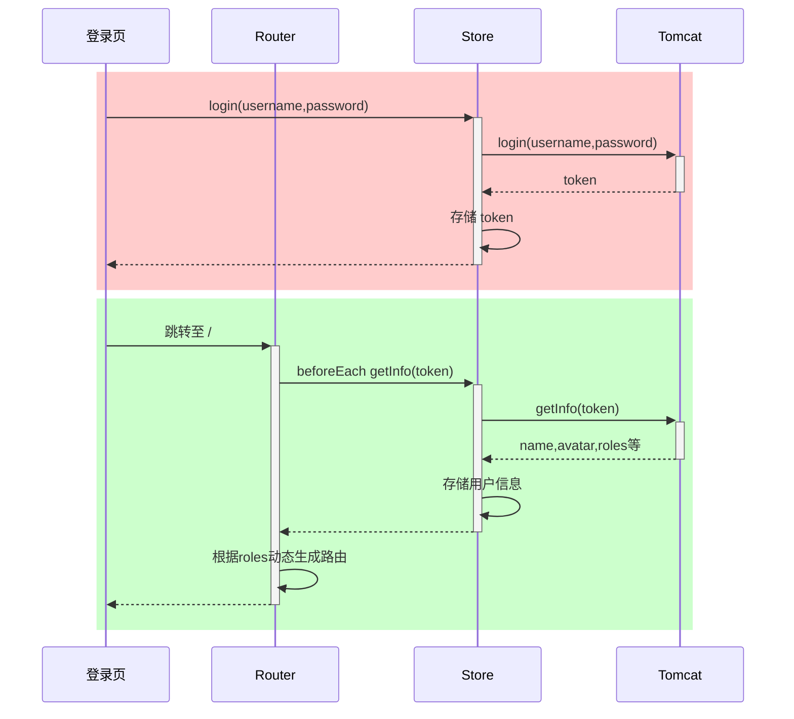
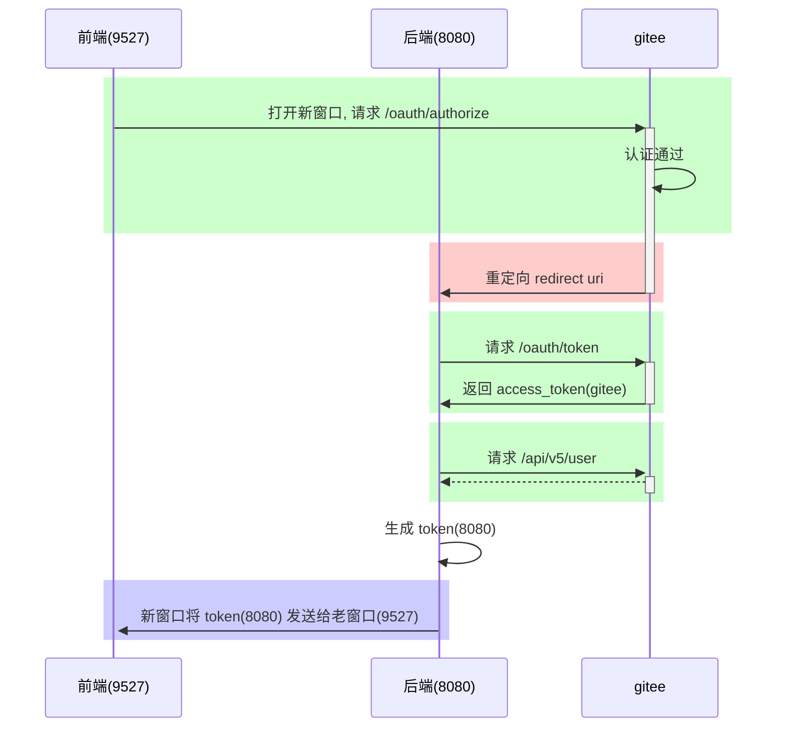

# 三、Vue 2 :id=h-b2b9d95fb753

Vue 2 プロジェクトで、コンポーネント、リクエスト、動的ルート、Vuex、管理画面を練習します。

**前提知識とバージョン：** Vue 2、Vue Router 3、Vuex 3、Element UI 2 の旧構成を使います。まずプロジェクトのロックファイルと Node のバージョンを確認してください。Vue 2 の公式サポートは終了しています。サンプルのバックエンド API は別途起動し、モックデータを実際のサービスとみなさないでください。

**スクリーンショットについて：** 画像には元の学習環境での操作手順を残しています。画像内の古い記述と本文が異なる場合は、改訂後の本文と選択したバージョンの公式ドキュメントに従ってください。

**サンプルの使い方：** 全ファイルと実行手順が明示されたプロジェクトを除き、コードブロックは各節の独立した断片です。省略記号や仮の名前は補ってください。誤りと記された行は問題を説明するためのものです。同じ節の代替コードを組み合わせないでください。

[ドキュメント一覧](README.md) · [公式リファレンス](https://v2.vuejs.org/v2/guide/)

**目次**

- [1. Vue の基礎](#section-1)
- [2. Vue の応用](#section-2)
- [3. Vue の実践](#section-3)

<a id="section-1"></a>

## 1. Vue の基礎 :id=h-0990ab49a08b

### 1）環境の準備 :id=h-7b44d6166c7a

#### プロジェクト作成ツールをインストールする :id=h-7365048a1fde

```
npm install -g @vue/cli
```

- -g はグローバルインストールを意味し、どのディレクトリからでも vue スクリプトでプロジェクトを作成できます。

#### プロジェクトを作成する :id=h-17b5ddebaefa

```cmd
vue ui
```

GUI のウィザードで Vue プロジェクトを作成します。次の画像のようにプロジェクト名を入力します。


手動のプロジェクト設定を選択する


Vue Router と Vuex を追加する


バージョンを選択してプロジェクトを作成する


#### devtools をインストールする :id=h-d7fcb8e798bd

- devtools 拡張機能：[https://devtools.vuejs.org/guide/installation.html](https://devtools.vuejs.org/guide/installation.html)


#### プロジェクトを実行する :id=h-9cc11e94f911

プロジェクトのディレクトリに移動し、次を実行します。

```cmd
npm run serve
```

#### ポートを変更する :id=h-6144b711a51b

フロントエンドサーバーはデフォルトで 8080 番ポートを使うため、変更します。

- ドキュメント：[DevServer | webpack](https://webpack.js.org/configuration/dev-server/#devserverport)

- vue.config.js を開き、次を追加します。

  ```js
  const { defineConfig } = require('@vue/cli-service')
  module.exports = defineConfig({

    // ...

    devServer: {
      port: 7070
    }

  })
  ```

#### プロキシを追加する :id=h-73d536ab8a6d

フロントエンドとバックエンドを結合して動作確認する際の fetch、XHR のクロスオリジン問題を避けるため、プロキシを設定します。

- ドキュメントは上記と同じです。

- vue.config.js を開き、次を追加します。

  ```js
  const { defineConfig } = require('@vue/cli-service')
  module.exports = defineConfig({

    // ...

    devServer: {
      port: 7070,
      proxy: {
        '/api': {
          target: 'http://localhost:8080',
          changeOrigin: true
        }
      }
    }

  })
  ```

#### Vue のプロジェクト構成 :id=h-95ef4ac94498

```
PS 代码\第3章\client> tree src
代码\第3章\CLIENT\SRC
├─assets
├─components
├─router
├─store
└─views
```

- assets：静的リソース
- components：再利用可能なコンポーネント
- router：ルーティング
- store：データ共有
- views：ビューコンポーネント

後で次も追加します。

- api：バックエンドと通信し、fetch・XHR リクエストを送信してレスポンスを受け取る
- plugins：プラグイン

### 2）Vue コンポーネント :id=h-f4aac9cf8faa

Vue のコンポーネントファイルは .vue で終わり、3 つの部分から成ります。

```vue
<template></template>

<script></script>

<style></style>
```

- template：HTML コードを生成するテンプレート部分
- script：テンプレートのデータ元と動作を制御するコード部分
- style：スタイル部分。ここでは通常あまり扱いません。

エントリーコンポーネントは App.vue です。

既存のコードを削除し、Hello, World の例を書きます。

```vue
<template>
  <h1>{{msg}}</h1>
</template>

<script>
export default {
  data() {
    return {
      msg: "Hello, Vue!"
    }
  }
}
</script>
```

説明

- export default は、main.js からインポートできるようコンポーネントオブジェクトをエクスポートします。
- このオブジェクトには data メソッドがあり、template にデータを渡す **オブジェクト** を返します。
- Vue では `{{}}` を補間式と呼び、data メソッドが返す **オブジェクト** のプロパティを **バインド** します。**バインド** とは、データが変化するとページの表示も同期して変わることです。

#### テキスト補間 :id=h-2d6dfa4aa2c2

```vue
<template>
    <div>
        <h1>{{ name }}</h1>
        <h1>{{ age > 60 ? '老年' : '青年' }}</h1>
    </div>
</template>
<script>
const options = {
    data: function () {
        return { name: '张三', age: 70 };
    }
};
export default options;
</script>
```

- 各補間には JavaScript の式を 1 つ書きます。{{ firstName + ' ' + lastName }} のように、複数のプロパティを同時に使えます。if などの文は書けません。
- template 内にはルート要素を 1 つだけ置けます。
- 補間内では簡単な式を計算できます。

#### 属性のバインド :id=h-5b6bbcba2ce0

```vue
<template>
    <div>
        <div><input type="text" v-bind:value="name"></div>
        <div><input type="date" v-bind:value="birthday"></div>
        <div><input type="text" :value="age"></div>
    </div>
</template>
<script>
const options = {
    data: function () {
        return { name: '王五', birthday: '1995-05-01', age: 20 };
    }
};
export default options;
</script>
```

- 省略形：v-bind を省略してコロンだけを残せます。

#### イベントのバインド :id=h-72c7b65bf501

```vue
<!-- See note 1 below. -->
<template>
    <div>
        <div><input type="button" value="点我执行m1" v-on:click="m1"></div>
        <div><input type="button" value="点我执行m2" @click="m2"></div>
        <div>{{count}}</div>
    </div>
</template>
<script>
const options = {
    data: function () {
        return { count: 0 };
    },
    methods: {
        m1() {
            this.count ++;
            console.log("m1")
        },
        m2() {
            this.count --;
            console.log("m2")
        }
    }
};
export default options;
</script>
```

例の説明：

1. イベントのバインド

- 省略形：v-on: を @ に置き換えられます。
- 通常の methods のメソッドでは、this はコンポーネントのインスタンスです。Vue が data のプロパティをインスタンスにプロキシするため、this.name と書けます。アロー関数にはこの this のバインドは行われません。

#### 双方向バインド :id=h-219bb5901d9b

```vue
<template>
    <div>
        <div>
            <label for="">请输入姓名</label>
            <input type="text" v-model="name">
        </div>
        <div>
            <label for="">请输入年龄</label>
            <input type="text" v-model="age">
        </div>
        <div>
            <label for="">请选择性别</label>
            男 <input type="radio" value="男" v-model="sex">
            女 <input type="radio" value="女" v-model="sex">
        </div>
        <div>
            <label for="">请选择爱好</label>
            游泳 <input type="checkbox" value="游泳" v-model="fav">
            打球 <input type="checkbox" value="打球" v-model="fav">
            健身 <input type="checkbox" value="健身" v-model="fav">
        </div>
    </div>
</template>
<script>
const options = {
    data: function () {
        return { name: '', age: null, sex:'男' , fav:['打球']};
    },
    methods: {
    }
};
export default options;
</script>
```

- v-model で双方向バインドを実現します。つまり、次の動作をします。
  - JavaScript のデータがフォーム要素に同期されます。
  - 逆に、フォーム要素への新しいユーザー入力も JavaScript 側に同期されます。
- 双方向バインドはフォームなど入力機能のある要素に適し、それ以外の要素へのデータバインドは一方向で十分です。
- チェックボックスの双方向バインドでは、JavaScript 側のデータに通常は配列を使います。

#### 算出プロパティ :id=h-cec2ac5e6bda

```vue
<!-- See note 1 below. -->
<template>
    <div>
        <h2>{{fullName}}</h2>
        <h2>{{fullName}}</h2>
        <h2>{{fullName}}</h2>
    </div>
</template>
<script>
const options = {
    data: function () {
        return { firstName: '三', lastName: '张' };
    },
    /* See note 2 below. */
    computed: {
        fullName() {
            console.log('进入了 fullName')
            return this.lastName + this.firstName;
        }
    }
};
export default options;
```

例の説明：

1. 算出プロパティ
2. methods: {; fullName() {; console.log('fullName に入った'); return this.lastName + this.firstName; } },

- 通常のメソッド呼び出しには () が必要で、キャッシュ機能はありません。
- 算出プロパティは通常のプロパティとして使い、() は付けません。キャッシュ機能があります。
  - 一度計算すると結果をキャッシュし、データが変わらなければ、次回は再計算せずキャッシュした結果を返します。

#### axios :id=h-6da2f317b6b5

Axios は内部で XMLHttpRequest（XHR）を使ってリクエストを送受信します。XHR は先に扱った Fetch API より機能が豊富ですが、古い API のため Promise に対応していません。Axios は XHR をラップして Promise に対応させ、リクエストとレスポンスを共通に扱うインターセプターも提供します。

インストール

```cmd
npm install axios -S
```

インポート

```js
import axios from 'axios'
```

- Axios のデフォルトエクスポートは、関数として呼び出せる Axios インスタンスで、get や post などのメソッドも備えています。

メソッド

| リクエスト                                | 補足     |
| ------------------------------------ | ------ |
| axios.get(url\[, config])            | :star: |
| axios.delete(url\[, config])         |        |
| axios.head(url\[, config])           |        |
| axios.options(url\[, config])        |        |
| axios.post(url\[, data\[, config]])  | :star: |
| axios.put(url\[, data\[, config]])   |        |
| axios.patch(url\[, data\[, config]]) |        |

- config：クエリパラメーターやリクエストヘッダーなどのオプションオブジェクト
- data：リクエスト本文のデータ。最も一般的なのは JSON 形式
- GET と HEAD はリクエスト本文を持てません。これはブラウザーの制限によるものと考えられ、XHR と Fetch API のどちらにも制限があります。
- OPTIONS と DELETE では、config 内の data にリクエスト本文を指定できます。

例

```vue
<template>
    <div>
        <input type="button" value="获取远程数据" @click="sendReq()">
    </div>
</template>
<script>
import axios from 'axios'
const options = {
    methods: {
        async sendReq() {
            // See note 1 below.
            // const resp = await axios.post('/api/a2');

            // See note 2 below.
            // const resp = await axios.post('/api/a3',{},{
            //     headers:{
            //         Authorization:'abc'
            //     }
            // });

            // See note 3 below.
            // const name = encodeURIComponent('&&&');
            // const age = 18;
            // const resp = await axios.post(`/api/a4?name=${name}&age=${age}`);

            // See note 4 below.
            // const resp = await axios.post('/api/a4', {}, {
            //     params: {
            //         name:'&&&&',
            //         age: 20
            //     }
            // });

            // See note 5 below.
            // const params = new URLSearchParams();
            // See note 6 below.
            // params.append("age", 24)

            // const resp = await axios.post('/api/a4', params);

            // See note 7 below.
            // const params = new FormData();
            // See note 8 below.
            // params.append("age", 30);
            // const resp = await axios.post('/api/a5', params);

            // See note 9 below.
            const resp = await axios.post('/api/a5json', {
                name: '王五',
                age: 50
            });

            console.log(resp);
        }
    }
};
export default options;
</script>
```

例の説明：

1. 1. GET と POST の実演
2. 2. リクエストヘッダーを送る
3. 3. リクエストにクエリパラメーター ?name=xxx\&age=xxx を付ける
4. 自分で文字列を組み立てたり特殊文字を処理したりしたくない場合は、次の方法を使います。
5. 4. リクエスト本文で urlencoded 形式のデータを送る
6. params.append("name", "張三");
7. 5. リクエスト本文で multipart 形式のデータを送る
8. params.append("name", "李四");
9. 6. リクエスト本文で JSON 形式のデータを送る

インスタンスを作成する

```js
const _axios = axios.create(config);
```

- axios オブジェクトは直接使えますが、デフォルト設定が適用されます。
- axios.create で作成したオブジェクトはデフォルト設定を上書きできます。config は以下を参照してください。

よく使う config の項目は次のとおりです。

| 名前              | 意味                                                       |
| --------------- | -------------------------------------------------------- |
| baseURL         | URL の前に自動で追加される                                          |
| headers         | リクエストヘッダー。通常のオブジェクトで指定する                                 |
| params          | URL の後ろに付くリクエストパラメーター。通常のオブジェクトまたは URLSearchParams で指定する |
| data            | リクエスト本文。通常のオブジェクト、FormData、URLSearchParams、File などで指定する  |
| withCredentials | クロスオリジンで Cookie などの認証情報を送るか。デフォルトは false                 |
| responseType    | レスポンスの型。デフォルトは JSON                                      |

例

```js
const _axios = axios.create({
    baseURL: 'http://localhost:8080',
    withCredentials: true
});
await _axios.post('/api/a6set')
await _axios.post('/api/a6get')
```

- 本番環境の XHR リクエストでプロキシを使わない場合、baseURL で一括変更できます。
- クロスオリジンで Cookie を送るには withCredentials: true を設定し、サーバー側も allowCredentials = true にします。そうしないと、ブラウザーがクロスオリジンの Cookie を受け取る際にエラーになります。

レスポンスの形式

| 名前      | 意味                 |
| ------- | ------------------ |
| data    | レスポンス本文のデータ :star: |
| status  | ステータスコード :star:    |
| headers | レスポンスヘッダー          |

- 200：レスポンス成功
- 400：age=abc などの不正なリクエストデータ
- 401：認証に失敗した
- 403：権限がない
- 404：リソースが存在しない
- 405：POST などのリクエストメソッドに未対応
- 500：サーバー内部エラー

リクエストインターセプター

```js
_axios.interceptors.request.use(
  function(config) {
    // See note 1 below.
    return config;
  },
  function(error) {
    return Promise.reject(error);
  }
);
```

例の説明：

1. 例えば、ここで共通の headers を追加する

レスポンスインターセプター

```js
_axios.interceptors.response.use(
  function(response) {
    // See note 1 below.
    return response;
  },
  function(error) {
    // See note 2 below.
    return Promise.reject(error);
  }
);
```

例の説明：

1. 2xx の範囲はここで処理する
2. 4xx、5xx など、2xx 以外は���こで処理する

#### 条件付きレンダリング :id=h-aee2280f5942

```vue
<template>
    <div>
        <input type="button" value="获取远程数据" @click="sendReq()">
        <div class="title">学生列表</div>
        <div class="thead">
            <div class="row bold">
                <div class="col">编号</div>
                <div class="col">姓名</div>
                <div class="col">性别</div>
                <div class="col">年龄</div>
            </div>
        </div>
        <div class="tbody">
            <div class="row" v-if="students.length > 0">显示学生数据</div>
            <div class="row" v-else>暂无学生数据</div>
        </div>
    </div>
</template>
<script>
import axios from '../util/myaxios'
const options = {
    data: function() {
        return {
            students: []
        };
    },
    methods : {
        async sendReq() {
            const resp = await axios.get("/api/students");
            console.log(resp.data.data)
            this.students = resp.data.data;
        }
    }
};
export default options;
</script>
<style scoped>
    div {
        font-family: 华文行楷;
        font-size: 20px;
    }

    .title {
        margin-bottom: 10px;
        font-size: 30px;
        color: #333;
        text-align: center;
    }

    .row {
        background-color: #fff;
        display: flex;
        justify-content: center;
    }

    .col {
        border: 1px solid #f0f0f0;
        width: 15%;
        height: 35px;
        text-align: center;
        line-height: 35px;
    }

    .bold .col {
        background-color: #f1f1f1;
    }
</style>
```

#### リストのレンダリング :id=h-569079d161a6

```vue
<template>
    <div>
        <!-- See note 1 below. -->
        <div class="title">学生列表</div>
        <div class="thead">
            <div class="row bold">
                <div class="col">编号</div>
                <div class="col">姓名</div>
                <div class="col">性别</div>
                <div class="col">年龄</div>
            </div>
        </div>
        <div class="tbody">
            <div v-if="students.length > 0">
                <div class="row" v-for="s of students" :key="s.id">
                    <div class="col">{{s.id}}</div>
                    <div class="col">{{s.name}}</div>
                    <div class="col">{{s.sex}}</div>
                    <div class="col">{{s.age}}</div>
                </div>
            </div>
            <div class="row" v-else>暂无学生数据</div>
        </div>
    </div>
</template>
<script>
import axios from '../util/myaxios'
const options = {
    mounted: function(){
        this.sendReq()
    },
    data: function() {
        return {
            students: []
        };
    },
    methods : {
        async sendReq() {
            const resp = await axios.get("/api/students");
            console.log(resp.data.data)
            this.students = resp.data.data;
        }
    }
};
export default options;
</script>
<style scoped>
    div {
        font-family: 华文行楷;
        font-size: 20px;
    }

    .title {
        margin-bottom: 10px;
        font-size: 30px;
        color: #333;
        text-align: center;
    }

    .row {
        background-color: #fff;
        display: flex;
        justify-content: center;
    }

    .col {
        border: 1px solid #f0f0f0;
        width: 15%;
        height: 35px;
        text-align: center;
        line-height: 35px;
    }

    .bold .col {
        background-color: #f1f1f1;
    }
</style>
```

例の説明：

1. \<input type="button" value="リモートデータを取得" @click="sendReq()">

- 同じタグで v-if と v-for を併用することは推奨しません。Vue 2 では v-for、Vue 3 では v-if が優先されます。外側に template を置くか、算出プロパティで先にリストを絞り込む方が明確です。
- v-for は特別な key 属性と組み合わせ、データを一意に識別できる値をバインドする必要があります。この例では学生 ID を使います。
- options の mounted は、コンポーネントのマウント完了後、準備が整ったときに呼ばれる関数です。その中で学生データを取得するリクエストを送れます。

#### コンポーネントの再利用 :id=h-4f701fe6c9da

ボタンコンポーネント

```vue
<template>
    <div class="button" :class="[type,size]">
        a<slot></slot>b
    </div>
</template>
<script>
const options = {
    props: ["type", "size"]
};
export default options;
</script>
```

- スタイル部分は省略しています。

コンポーネントの使用

```vue
<template>
    <div>
        <h1>父组件</h1>
        <my-button type="primary" size="small">1</my-button>
        <my-button type="danger" size="middle">2</my-button>
        <my-button type="success" size="large">3</my-button>
    </div>
</template>
<script>
import MyButton from '../components/MyButton.vue'
const options = {
    components: {
        MyButton
    }
};
export default options;
</script>
```

<a id="section-2"></a>

## 2. Vue の応用 :id=h-5a79d7f8c429

### 1) ElementUI :id=h-d35fa8c7c5c3

インストール

```cmd
npm install element-ui -S
```

コンポーネントを取り込む

```js
import Element from 'element-ui'
import 'element-ui/lib/theme-chalk/index.css'

Vue.use(Element)
```

自分のコンポーネントで ElementUI のコンポーネントを使い、動作を確認します。

```vue
<el-button>按钮</el-button>
```

#### テーブルコンポーネント :id=h-04abd92104b0

```vue
<template>
    <div>
        <el-table :data="students">
            <el-table-column label="编号" prop="id"></el-table-column>
            <el-table-column label="姓名" prop="name"></el-table-column>
            <el-table-column label="性别" prop="sex"></el-table-column>
            <el-table-column label="年龄" prop="age"></el-table-column>
        </el-table>
    </div>
</template>
<script>
import axios from '../util/myaxios'
const options = {
    async mounted() {
        const resp = await axios.get('/api/students');
        this.students = resp.data.data
    },
    data() {
        return {
            students: []
        }
    }
}
export default options;
</script>
```

#### ページネーションコンポーネント :id=h-f57c3b805210

```vue
<template>
    <div>
        <el-table v-bind:data="students">
            <el-table-column label="编号" prop="id"></el-table-column>
            <el-table-column label="姓名" prop="name"></el-table-column>
            <el-table-column label="性别" prop="sex"></el-table-column>
            <el-table-column label="年龄" prop="age"></el-table-column>
        </el-table>
        <el-pagination
            :total="total"
            :page-size="queryDto.size"
            :current-page="queryDto.page"
            layout="prev,pager,next,sizes,->,total"
            :page-sizes="[5,10,15,20]"
            @current-change="currentChange"
            @size-change="sizeChange"
        ></el-pagination>
    </div>
</template>
<script>
import axios from '../util/myaxios'
const options = {
    mounted() {
        this.query();
    },
    methods: {
        currentChange(page) {
            this.queryDto.page = page;
            this.query();
        },
        sizeChange(size){
            this.queryDto.size = size;
            this.query();
        },
        async query() {
            const resp = await axios.get('/api/students/q', {
                params: this.queryDto
            });
            this.students = resp.data.data.list;
            this.total = resp.data.data.total;
        }
    },
    data() {
        return {
            students: [],
            total: 0,
            queryDto: {
                page: 1,
                size: 5
            }
        }
    }
}
export default options;
</script>
```

- 次の 3 つの場合すべてで検索を実行する必要があります。
  - mounted：コンポーネントのマウント完了後
  - ページ番号が変わったとき
  - 1 ページの件数が変わったとき
- 検索パラメーターの渡し方は、バックエンドの要件に応じて柔軟に選びます。
  - この例は GET リクエストなので本文は使えず、params でパラメーターを渡します。
- 返されるレスポンスの構造は複雑な場合があります。返された構造に応じてデータを取得する力が必要です。

#### ページ分割した検索 :id=h-1e33374c02fc

```vue
<template>
    <div>
        <el-input placeholder="请输入姓名" size="mini" v-model="queryDto.name"></el-input>
        <el-select placeholder="请选择性别" size="mini" v-model="queryDto.sex" clearable>
            <el-option value="男"></el-option>
            <el-option value="女"></el-option>
        </el-select>
        <el-select placeholder="请选择年龄" size="mini" v-model="queryDto.age" clearable>
            <el-option value="0,20" label="0到20岁"></el-option>
            <el-option value="21,30" label="21到30岁"></el-option>
            <el-option value="31,40" label="31到40岁"></el-option>
            <el-option value="41,120" label="41到120岁"></el-option>
        </el-select>
        <el-button type="primary" size="mini" @click="search()">搜索</el-button>
        <el-divider></el-divider>
        <el-table v-bind:data="students">
            <el-table-column label="编号" prop="id"></el-table-column>
            <el-table-column label="姓名" prop="name"></el-table-column>
            <el-table-column label="性别" prop="sex"></el-table-column>
            <el-table-column label="年龄" prop="age"></el-table-column>
        </el-table>
        <el-pagination :total="total" :page-size="queryDto.size" :current-page="queryDto.page"
            layout="prev,pager,next,sizes,->,total" :page-sizes="[5, 10, 15, 20]" @current-change="currentChange"
            @size-change="sizeChange"></el-pagination>
    </div>
</template>
<script>
import axios from '../util/myaxios'
const options = {
    mounted() {
        this.query();
    },
    methods: {
        currentChange(page) {
            this.queryDto.page = page;
            this.query();
        },
        sizeChange(size) {
            this.queryDto.size = size;
            this.query();
        },
        async query() {
            const resp = await axios.get('/api/students/q', {
                params: this.queryDto
            });
            this.students = resp.data.data.list;
            this.total = resp.data.data.total;
        },
        search() {
            this.query();
        }
    },
    data() {
        return {
            students: [],
            total: 0,
            queryDto: {
                name: '',
                sex: '',
                age: '',
                page: 1,
                size: 5
            }
        }
    }
}
export default options;
</script>
```

- sex と age はどちらも `''` で未選択を表します。
- age が `0,20` の場合、Spring は `new int[]{0, 20}` に変換します。
- age が `''` の場合、Spring は `new int[0]` に変換します。

#### 連動する選択 :id=h-efbae49ca1e2

カスケードセレクターの選択肢のデータ構造は次のとおりです。

```js
[
    {value:100, label:'主页',children:[
        {value:101, label:'菜单1', children:[
            {value:105, label:'子项1'},
            {value:106, label:'子项2'}
        ]},
        {value:102, label:'菜单2', children:[
            {value:107, label:'子项3'},
            {value:108, label:'子项4'},
            {value:109, label:'子项5'}
        ]},
        {value:103, label:'菜单3', children:[
            {value:110, label:'子项6'},
            {value:111, label:'子项7'}
        ]},
        {value:104, label:'菜单4'}
    ]}
]
```

次の例では、バックエンドが返す 1 次元配列をツリー構造に変換します。

```vue
<template>
    <el-cascader :options="ops"></el-cascader>
</template>
<script>
import axios from '../util/myaxios'
const options = {
    async mounted() {
        const resp = await axios.get('/api/menu')
        console.log(resp.data.data)
        const array = resp.data.data;

        const map = new Map();

        // See note 1 below.
        for(const {id,name,pid} of array) {
            map.set(id, {value:id, label:name, pid:pid})
        }
        // See note 2 below.
        // See note 3 below.
        const top = [];
        for(const obj of map.values()) {
            const parent = map.get(obj.pid);
            if(parent !== undefined) {
                parent.children ??= [];
                parent.children.push(obj);
            } else {
                top.push(obj)
            }
        }
        this.ops = top;
    },
    data(){
        return {
            ops: []
        }
    }
};
export default options;
</script>
```

例の説明：

1. 1. 後の検索を効率化するため、すべてのデータを map に保存する
2. 2. 親子関係を作る
3. 3. 最上位のオブジェクトを探す

### 2) Vue-Router :id=h-505809108377

Vue は単一ページアプリケーションです。ルーティングとは、ブラウザーのパスに応じて異なる **ビューコンポーネント** に差し替え、ページの表示内容を変えることです。

#### ルートを設定する :id=h-1bf98f0b352b

src/router/example14.js などのルーティング用 JavaScript ファイルを作成し、次の内容を記述します。

```js
import Vue from 'vue'
import VueRouter from 'vue-router'
import ContainerView from '@/views/example14/ContainerView.vue'
import LoginView from '@/views/example14/LoginView.vue'
import NotFoundView from '@/views/example14/NotFoundView.vue'

Vue.use(VueRouter)

const routes = [
  {
    path:'/',
    component: ContainerView
  },
  {
    path:'/login',
    component: LoginView
  },
  {
    path:'/404',
    component: NotFoundView
  }
]

const router = new VueRouter({
  routes
})

export default router
```

- 最も重要なのは、パスとビューコンポーネントの対応関係を作ることです。
- この例では 3 つのパスと対応するビューコンポーネントを設定しています。

main.js で作成したルーティング用 JavaScript を使います。

```js
import Vue from 'vue'
import e14 from './views/Example14View.vue'
import router from './router/example14'  // See note 1 below.
import store from './store'
import Element from 'element-ui'
import 'element-ui/lib/theme-chalk/index.css'

Vue.config.productionTip = false

Vue.use(Element)
new Vue({
  router,
  store,
  render: h => h(e14)
}).$mount('#app')
```

例の説明：

1. ここを変更する

ルートコンポーネントは Example14View\.vue で、内容は次のとおりです。

```vue
<template>
    <div class="all">
        <router-view></router-view>
    </div>
</template>
```

- スタイルは省略
- `<router-view>` は表示位置を確保します。パスを変えると、対応するビューコンポーネントが `<router-view>` の位置に入り、以前の内容を置き換えます。

#### 動的インポート :id=h-b6d3f215fdb3

```js
import Vue from 'vue'
import VueRouter from 'vue-router'

Vue.use(VueRouter)

const routes = [
  {
    path:'/',
    component: () => import('@/views/example14/ContainerView.vue')
  },
  {
    path:'/login',
    component: () => import('@/views/example14/LoginView.vue')
  },
  {
    path:'/404',
    component: () => import('@/views/example14/NotFoundView.vue')
  }
]

const router = new VueRouter({
  routes
})

export default router
```

- 静的インポートは全コンポーネントの JavaScript をまとめます。コンポーネントが非常に多いとファイルが大きくなり、ページの読み込み速度に影響します。
- 動的インポートはコンポーネントの JavaScript を独立したファイルに分け、使うときだけ読み込みます。

#### 入れ子のルート :id=h-92b2ace80c19

コンポーネント内の内容を切り替えるには、入れ子のルート（子ルート）を使います。次の例は ContainerView 内に 3 つの子ルートを定義します。

```js
const routes = [
  {
    path:'/',
    component: () => import('@/views/example14/ContainerView.vue'),
    redirect: '/c/p1',
    children: [
      {
        path:'c/p1',
        component: () => import('@/views/example14/container/P1View.vue')
      },
      {
        path:'c/p2',
        component: () => import('@/views/example14/container/P2View.vue')
      },
      {
        path:'c/p3',
        component: () => import('@/views/example14/container/P3View.vue')
      }
    ]
  },
  {
    path:'/login',
    component: () => import('@/views/example14/LoginView.vue')
  },
  {
    path:'/404',
    component: () => import('@/views/example14/NotFoundView.vue')
  },
  {
    path:'*',
    redirect: '/404'
  }
]
```

子ルートが変わると、ContainerView 内の `<router-view></router-view>` の内容が切り替わります。

```vue
<template>
    <div class="container">
        <router-view></router-view>
    </div>
</template>
```

- redirect は新しいアドレスへリダイレクトします。
- path が \* の場合、ほかの path に一致しないときに一致します。

#### ElementUI のレイアウト :id=h-535f892b4b5c

通常、ホームページにはレイアウトが必要です。以下は ElementUI が提供する、上部と、その下の左右の領域から成るレイアウトです。

```vue
<template>
    <div class="container">
        <el-container>
            <el-header></el-header>
            <el-container>
                <el-aside width="200px"></el-aside>
                <el-main>
                    <router-view></router-view>
                </el-main>
            </el-container>
        </el-container>
    </div>
</template>
```

#### ルート間の移動 :id=h-6567e435972a

##### タグによる宣言的な方法 :id=h-52759389efb1

```vue
<el-aside width="200px">
    <router-link to="/c1/p1">P1</router-link>
    <router-link to="/c1/p2">P2</router-link>
    <router-link to="/c1/p3">P3</router-link>
</el-aside>
```

##### プログラムによる方法 :id=h-a9a1d67e7d6d

```vue
<el-header>
    <el-button type="primary" icon="el-icon-edit"
               circle size="mini" @click="jump('/c1/p1')"></el-button>
    <el-button type="success" icon="el-icon-check"
               circle size="mini" @click="jump('/c1/p2')"></el-button>
    <el-button type="warning" icon="el-icon-star-off"
               circle size="mini" @click="jump('/c1/p3')"></el-button>
</el-header>
```

jump メソッド

```vue
<script>
const options = {
    methods : {
        jump(url) {
            this.$router.push(url);
        }
    }
}
export default options;
</script>
```

- this.$router でルーターオブジェクトを取得します。
- push メソッドは URL に応じて移動します。

##### ナビゲーションメニュー :id=h-d9b22ff5df40

```vue
<el-menu router background-color="#545c64" text-color="#fff" active-text-color="#ffd04b">
    <el-submenu index="/c1">
        <span slot="title">
            <i class="el-icon-platform-eleme"></i>
            菜单1
        </span>
        <el-menu-item index="/c1/p1">子项1</el-menu-item>
        <el-menu-item index="/c1/p2">子项2</el-menu-item>
        <el-menu-item index="/c1/p3">子项3</el-menu-item>
    </el-submenu>
    <el-menu-item index="/c2">
        <span slot="title">
            <i class="el-icon-phone"></i>
            菜单2
        </span>
    </el-menu-item>
    <el-menu-item index="/c3">
        <span slot="title">
            <i class="el-icon-star-on"></i>
            菜单3
        </span>
    </el-menu-item>
</el-menu>
```

- アイコンとメニュー項目の文字は `<span slot='title'></span>` で囲むことを勧めます。
- `el-menu` タグに `router` 属性を付けると、ナビゲーションメニューとルーターが連携し、メニュー項目の `index` 属性でルートへ移動できます。

#### 動的ルートとメニュー :id=h-2497cfc61b26

ホームページのメニューとルート情報をデータベースに保存します。

```sql
insert into menu(id, name, pid, path, component, icon) values
    (101, '菜单1', 0,   '/m1',    null,         'el-icon-platform-eleme'),
    (102, '菜单2', 0,   '/m2',    null,         'el-icon-delete-solid'),
    (103, '菜单3', 0,   '/m3',    null,         'el-icon-s-tools'),
    (104, '菜单4', 0,   '/m4',    'M4View.vue', 'el-icon-user-solid'),
    (105, '子项1', 101, '/m1/c1', 'C1View.vue', 'el-icon-s-goods'),
    (106, '子项2', 101, '/m1/c2', 'C2View.vue', 'el-icon-menu'),
    (107, '子项3', 102, '/m2/c3', 'C3View.vue', 'el-icon-s-marketing'),
    (108, '子项4', 102, '/m2/c4', 'C4View.vue', 'el-icon-s-platform'),
    (109, '子项5', 102, '/m2/c5', 'C5View.vue', 'el-icon-picture'),
    (110, '子项6', 103, '/m3/c6', 'C6View.vue', 'el-icon-upload'),
    (111, '子项7', 103, '/m3/c7', 'C7View.vue', 'el-icon-s-promotion');
```

ユーザーによって、取得するメニューやルート情報は異なります。

例えば `/api/menu/admin` にアクセスすると、すべてのデータを返します。

```json
[
    {
        "id": 102,
        "name": "菜单2",
        "icon": "el-icon-delete-solid",
        "path": "/m2",
        "pid": 0,
        "component": null
    },
    {
        "id": 107,
        "name": "子项3",
        "icon": "el-icon-s-marketing",
        "path": "/m2/c3",
        "pid": 102,
        "component": "C3View.vue"
    },
    {
        "id": 108,
        "name": "子项4",
        "icon": "el-icon-s-platform",
        "path": "/m2/c4",
        "pid": 102,
        "component": "C4View.vue"
    },
    {
        "id": 109,
        "name": "子项5",
        "icon": "el-icon-picture",
        "path": "/m2/c5",
        "pid": 102,
        "component": "C5View.vue"
    }
]
```

`/api/menu/wang` にアクセスすると、次を返します。

```json
[
    {
        "id": 103,
        "name": "菜单3",
        "icon": "el-icon-s-tools",
        "path": "/m3",
        "pid": 0,
        "component": null
    },
    {
        "id": 110,
        "name": "子项6",
        "icon": "el-icon-upload",
        "path": "/m3/c6",
        "pid": 103,
        "component": "C6View.vue"
    },
    {
        "id": 111,
        "name": "子项7",
        "icon": "el-icon-s-promotion",
        "path": "/m3/c7",
        "pid": 103,
        "component": "C7View.vue"
    }
]
```

フロントエンドはユーザーの識別情報に応じて、動的にルートを追加してメニューを表示します。

##### 動的ルート :id=h-33be6ca38199

```js
const pageLoaders = {
  'M4View.vue': () => import('@/views/example15/container/M4View.vue'),
  'C1View.vue': () => import('@/views/example15/container/C1View.vue'),
  'C2View.vue': () => import('@/views/example15/container/C2View.vue'),
  'C3View.vue': () => import('@/views/example15/container/C3View.vue'),
  'C4View.vue': () => import('@/views/example15/container/C4View.vue'),
  'C5View.vue': () => import('@/views/example15/container/C5View.vue'),
  'C6View.vue': () => import('@/views/example15/container/C6View.vue'),
  'C7View.vue': () => import('@/views/example15/container/C7View.vue')
};

export function addServerRoutes(array) {
  for (const { id, path, component } of array) {
    if (component === null) continue;
    const loader = Object.prototype.hasOwnProperty.call(pageLoaders, component)
      ? pageLoaders[component]
      : undefined;
    if (!loader) throw new Error('Unknown route component');
    router.addRoute('c', {
      path,
      name: String(id),
      component: loader
    });
  }
}
```

- JavaScript 側にはホーム、404、login など少数の固定ルートだけを残します。
- このメソッドはサーバーから返されたルート情報を、c という親ルートに追加します。
- 動的 import で解決できる範囲はビルドツールによって決まり、すべての文字列を実行時にインポートできるわけではありません。プログラムで事前登録したコンポーネントの対応表を使い、バックエンドは許可されたキー名だけを送るようにします。

##### ルートをリセットする :id=h-852b5d270937

ユーザーのログアウト時にルートをリセットする必要があります。

```js
export function resetRouter() {
  router.matcher = new VueRouter({ routes }).matcher
}
```

##### ページの再読み込み :id=h-41b083f519c2

ページを再読み込みすると、動的に追加したルートが失われます。対策としてルートデータを sessionStorage に保存します。

```vue
<script>
import axios from '@/util/myaxios'
import {resetRouter, addServerRoutes} from '@/router/example15'
const options = {
    data() {
        return {
            username: 'admin'
        }
    },
    methods: {
        async login() {
            resetRouter(); // See note 1 below.
            const resp = await axios.get(`/api/menu/${this.username}`)
            const array = resp.data.data;
            // See note 2 below.
            // See note 3 below.
            sessionStorage.setItem('serverRoutes', JSON.stringify(array))
            addServerRoutes(array); // See note 4 below.
            this.$router.push('/');
        }
    }
}
export default options;
</script>
```

例の説明：

1. ルートをリセットする
2. localStorage：ブラウザーを閉じてもデータが残る
3. sessionStorage：タブ単位で保存し、タブを閉じるとデータが消える
4. ルートを動的に追加する

ページの再読み込みでルーターを再作成するとき、sessionStorage からルートデータを復元します。

```js
const router = new VueRouter({
  routes
})

// See note 1 below.
const serverRoutes = sessionStorage.getItem('serverRoutes');
if(serverRoutes) {
  const array = JSON.parse(serverRoutes);
  addServerRoutes(array) // See note 2 below.
}
```

例の説明：

1. sessionStorage からルートデータを復元する
2. ルートを動的に追加する

##### 動的メニュー :id=h-3d50d5fb39ff

コード部分

```vue
<script>
const options = {
    mounted() {
        const serverRoutes = sessionStorage.getItem('serverRoutes');
        const array = JSON.parse(serverRoutes);
        const map = new Map();
        for(const obj of array) {
            map.set(obj.id, obj);
        }
        const top = [];
        for(const obj of array) {
            const parent = map.get(obj.pid);
            if(parent) {
                parent.children ??= [];
                parent.children.push(obj);
            } else {
                top.push(obj);
            }
        }
        this.top = top;
    },
    data() {
        return {
            top: []
        }
    }
}
export default options;
</script>
```

メニュー部分

```vue
<el-menu router background-color="#545c64" text-color="#fff" active-text-color="#ffd04b" :unique-opened="true">
    <template v-for="m1 of top">
<el-submenu v-if="m1.children" :key="m1.id" :index="m1.path">
    <span slot="title">
        <i :class="m1.icon"></i> {{m1.name}}
        </span>
    <el-menu-item v-for="m2 of m1.children" :key="m2.id" :index="m2.path">
        <span slot="title">
            <i :class="m2.icon"></i> {{m2.name}}
        </span>
        </el-menu-item>
        </el-submenu>
<el-menu-item v-else :key="m1.id" :index="m1.path">
    <span slot="title">
        <i :class="m1.icon"></i> {{m1.name}}
        </span>
        </el-menu-item>
    </template>
</el-menu>
```

- メニューは 2 階層のみとし、再帰的なメニューは考慮していません。

### 3) Vuex :id=h-df1d52502bad

#### 入門 :id=h-18c6d4765a22

Vuex は複数のコンポーネントでデータを共有でき、そのデータはリアクティブです。つまり、データの変更が適時テンプレートに描画されます。

- localStorage と sessionStorage もデータを共有できますが、リアクティブではないという欠点があります。

まず state と mutations を定義します。それぞれ共有データの読み取りと変更に使います。

src/store/index.js

```js
import Vue from 'vue'
import Vuex from 'vuex'

Vue.use(Vuex)

/* See note 1 below. */
export default new Vuex.Store({
  state: {
    name: '',
    age: 18
  },
  getters: {
  },
  mutations: {
    updateName(state, name) {
      state.name = name;
    }
  },
  actions: {
  },
  modules: {
  }
})
```

例の説明：

1. 読み取りは state、getters、変更は mutations、actions を使う。

共有データを変更する

```vue
<template>
    <div class="p">
        <el-input placeholder="请修改用户姓名"
            size="mini" v-model="name"></el-input>
        <el-button type="primary" size="mini" @click="update()">修改</el-button>
    </div>
</template>
<script>
const options = {
    methods: {
        update(){
            this.$store.commit('updateName', this.name);
        }
    },
    data () {
        return {
            name:''
        }
    }
}
export default options;
</script>
```

- mutations のメソッドは直接呼べず、`store.commit(mutation方法名, 参数)` を通じて間接的に呼びます。

共有データを読む

```vue
<template>
    <div class="container">
        <el-container>
            <el-header>
                <div class="t">
                    欢迎您：{{ $store.state.name }}, {{ $store.state.age }}
                </div>
            </el-header>
            <el-container>
                <el-aside width="200px">
                </el-aside>
                <el-main>
                    <router-view></router-view>
                </el-main>
            </el-container>
        </el-container>
    </div>
</template>
```

#### mapState :id=h-b72c9be2fd3e

毎回 `$store.state.name` のように書くのは煩雑なので、Vuex で算出プロパティを生成できます。

```vue
<template>
    <div class="container">
        <el-container>
            <el-header>
                <div class="t">欢迎您：{{ name }}, {{ age }}</div>
            </el-header>
            <el-container>
                <el-aside width="200px">
                </el-aside>
                <el-main>
                    <router-view></router-view>
                </el-main>
            </el-container>
        </el-container>
    </div>
</template>
<script>
import { mapState } from 'vuex'
const options = {
    computed: {
        ...mapState(['name', 'age'])
    }
}
export default options;
</script>
```

- mapState は、name() と age() の 2 つのメソッドを算出プロパティとして含むオブジェクトを返します。
- このオブジェクトを `...` のスプレッド構文で computed に展開すれば使えます。

#### mapMutations :id=h-f3d4ec028ea7

```vue
<template>
    <div class="p">
        <el-input placeholder="请修改用户姓名"
            size="mini" v-model="name"></el-input>
        <el-button type="primary" size="mini" @click="updateName(name)">修改</el-button>
    </div>
</template>
<script>
import {mapMutations} from 'vuex'
const options = {
    methods: {
        ...mapMutations(['updateName'])
    },
    data () {
        return {
            name:''
        }
    }
}
export default options;
</script>
```

- 同様に、共有データを変更する mutation の呼び出しも簡略化できます。
- mapMutations が返すオブジェクトのメソッドは、store.commit() を呼んで mutation を実行します。
- 引数の渡し方が少し異なることに注意してください。

#### actions :id=h-fb3f7164ef27

mutations に変更が即時反映されないコードを含めると、Vuex の開発ツールが正確に動作しなくなります。そのようなコードは actions に記述してください。

```js
import Vue from 'vue'
import Vuex from 'vuex'

Vue.use(Vuex)

/* See note 1 below. */
import axios from '@/util/myaxios'
export default new Vuex.Store({
  state: {
    name: '',
    age: 18
  },
  getters: {
  },
  mutations: {
    updateName(state, name) {
      state.name = name;
    },
    // See note 2 below.
    /* async updateServerName(state) {
      const resp = await axios.get('/api/user');
      const {name, age} = resp.data.data;
      state.name = name;
      state.age = age;
    } */
    updateServerName(state, user) {
      const { name, age } = user;
      state.name = name;
      state.age = age;
    }
  },
  actions: {
    async updateServerName(context) {
      const resp = await axios.get('/api/user');
      context.commit('updateServerName', resp.data.data)
    }
  },
  modules: {
  }
})
```

例の説明：

1. 読み取りは state、getters、変更は mutations、actions を使う。
2. 誤った使い方。mutations に非同期操作を含めると、開発ツールが不正確になる。

- まず actions の updateServerName を呼んでデータを取得します。
- その後、そこから mutations の updateServerName を間接的に呼び、共有データを更新します。

ページで actions を使うコードは次のように書けます。

```vue
<template>
    <div class="p">
        <el-button type="primary" size="mini"
            @click="updateServerName()">从服务器获取数据,存入store</el-button>
    </div>
</template>
<script>
import { mapActions } from 'vuex'
const options = {
    methods: {
        ...mapActions(['updateServerName'])
    }
}
export default options;
</script>
```

- mapActions は actions のメソッドを呼ぶコードを生成します。

- actions の呼び出しは内部では次と同等です。Promise を返すため、await や then で非同期結果を受け取れます。

  ```js
  this.$store.dispatch('action名称', 参数)
  ```

<a id="section-3"></a>

## 3. Vue の実践 :id=h-a52044e2bee0

この講座では Vue プロジェクトを一から開発しません。比較的典型的な Vue ベースのプロジェクトの実装を一緒に読み、重要な流れをいくつか分析する方法で進めます。

これまで学んだ技術とよく合うため、vue-element-admin をプロジェクトのひな形として選びます。

- vue 2
- element-ui 2
- vue-router 3
- vuex 3
- axios

### インストール :id=h-f40c9aac0afc

```cmd
git clone https://gitee.com/panjiachen/vue-element-admin.git client-action

cd client-action

git branch -a

git checkout -b i18n remotes/origin/i18n

git config --global url."https://".insteadOf git://

npm install

npm run dev
```

- i18n ブランチへ切り替え���必要があります。そうしないと、中国語を含む国際化機能を使えません。
- インストールに失敗したら、まずエラーを読み、ネットワーク、Node のバージョン、依存関係の競合を区別します。原因を確認せず繰り返しインストールしないでください。有効なロックファイルがあれば npm ci を優先し、プロジェクトで指定された Node のバージョンを使います。
- npm run dev を実行するとブラウザーが自動で開き、9527 番ポートを使います。

### バックエンドのパス :id=h-04e0ae5323c7

開発環境で次のコマンドを実行します。

```
npm run dev
```

- mock-server も同時に起動します。

開発環境では、バックエンドへのベースパスを `.env.development` に設定します。

```properties
VUE_APP_BASE_API = '/dev-api'
```

- デフォルトのバックエンドリクエストは `http://localhost:9527/dev-api` の mock-server に送られ、すべて模擬データが返されます。
- 実際のバックエンドと結合確認するときは、上記のアドレスを `VUE_APP_BASE_API = 'http://localhost:8080/api'` に変更できます。

リクエストを送る Axios のユーティリティは src/utils/request.js にまとめられています。

```js
import axios from 'axios'
import { MessageBox, Message } from 'element-ui'
import store from '@/store'
import { getToken } from '@/utils/auth'

// create an axios instance
const service = axios.create({
  baseURL: process.env.VUE_APP_BASE_API, // url = base url + request url
  // withCredentials: true, // send cookies when cross-domain requests
  timeout: 5000 // request timeout
})

// ...
```

元のコードの URI パスは次の形式です。

```
/vue-element-admin/user/login
/vue-element-admin/user/info
/vue-element-admin/user/logout
...
```

必要なら一括置換できます。

```
/user/login
/user/info
/user/logout
...
```

src/utils/request.js でトークンのリクエストヘッダーを変更します。

```js
// Other interceptor setup goes here.
service.interceptors.request.use(
  config => {
    // do something before request is sent

    if (store.getters.token) {
      // let each request carry token
      // ['X-Token'] is a custom headers key
      // please modify it according to the actual situation
      config.headers['Authorization'] = getToken()
    }
    return config
  },
  error => {
    // do something with request error
    console.log(error) // for debug
    return Promise.reject(error)
  }
)
// Other interceptor setup goes here.
```

### ログインの流れ :id=h-c6c10ed33bb0

#### 1. `src/views/login/index.vue` :id=h-37c21ee77ecf

```vue
<script>
import { validUsername } from '@/utils/validate'
import LangSelect from '@/components/LangSelect'
import SocialSign from './components/SocialSignin'

export default {
  // ...
  methods: {
    handleLogin() {
      this.$refs.loginForm.validate(valid => {
        if (valid) {
          this.loading = true
          this.$store.dispatch('user/login', this.loginForm)
            .then(() => {
              this.$router.push({ path: this.redirect || '/', query: this.otherQuery })
              this.loading = false
            })
            .catch(() => {
              this.loading = false
            })
        } else {
          console.log('error submit!!')
          return false
        }
      })
    }
    // ...
  }
}
</script>
```

ここでは store の action である `user/login` を呼びます。

- 非同期呼び出しなので、actions を使います。
- ログイン成功後は this.redirect のパスを優先し、なければ / に移動します。
- `src/router/index.js` のルート表を見ると、/ は /dashboard にリダイレクトすることが分かります。

#### 2. `src/store/modules/user.js` :id=h-0e5989cce14f

```js
import { login, logout, getInfo } from '@/api/user'
// ...
const actions = {
  // user login
  login({ commit }, userInfo) {
    const { username, password } = userInfo
    return new Promise((resolve, reject) => {
      login({ username: username.trim(), password: password }).then(response => {
        const { data } = response
        commit('SET_TOKEN', data.token)
        setToken(data.token)
        resolve()
      }).catch(error => {
        reject(error)
      })
    })
  }
  // ...
}
```

- リクエストには `src/api/user.js` を使います。成功すると commit で mutation を呼んでトークンを保存し、Cookie にも保存します。
- ここでの response は実際には response.data です。後述の説明を参照してください。
- 考察
  - ここでは Cookie または sessionStorage にトークンを保存すれば十分です。トークンをリアクティブにする必要はなく、store に入れる必要もありません。
  - 作者は Promise API を使っていますが、await に変えると読みやすくできます。

#### 3. `src/api/user.js` :id=h-ca0f7437649d

```js
import request from '@/utils/request'

export function login(data) {
  return request({
    url: '/user/login',
    method: 'post',
    data
  })
}

// ...
```

- request は先に作成した myaxios に相当します。

#### 4. `src/utils/request.js` :id=h-c65087ce5bf6

```js
import axios from 'axios'
import { MessageBox, Message } from 'element-ui'
import store from '@/store'
import { getToken } from '@/utils/auth'

// create an axios instance
const service = axios.create({
  baseURL: process.env.VUE_APP_BASE_API, // url = base url + request url
  // withCredentials: true, // send cookies when cross-domain requests
  timeout: 5000 // request timeout
})

// ...

service.interceptors.response.use(
  // ...
  response => {
    const res = response.data
    if (res.code !== 20000) {
      // ...
    } else {
      return res
    }
  },
  error => {
    // ...
  }
)

export default service
```

- レスポンスインターセプターは正常なレスポンスで resp.data を返すため、ほかのコードで分割代入するときに data の階層が 1 つ少なくなります。

#### 5. `src/permission.js` :id=h-7793a5c70b8d

ログイン成功時にはトークンを取得しただけで、ユーザー情報はまだありません。ユーザー情報はルート移動の beforeEach で取得します。



重要なコード

```js
import router from './router'

// ...

router.beforeEach(async(to, from, next) => {
  // ...
  const hasToken = getToken()

  if (hasToken) {
    if (to.path === '/login') {
      // ...
    } else {
      // ...
      const { roles } = await store.dispatch('user/getInfo')
      // ...
    }
  } else {
    // ...
  }
})
```

- ログイン後、/ に移動する前にこの beforeEach が実行され、主に 2 つの処理を行います。
  - 1 つ目は actions でユーザーのロールを取得する処理です。6 を参照してください。
  - 2 つ目はロールに応じたルートの動的生成です。7 を参照してください。

#### 6. `src/store/modules/user.js` :id=h-46db10c4fc6c

getInfo メソッドでユーザー情報を取得し、ロールを beforeEach に返します。

```js
import { login, logout, getInfo } from '@/api/user'
// ...
const actions = {
  getInfo({ commit, state }) {
    return new Promise((resolve, reject) => {
      getInfo(state.token).then(response => {
        const { data } = response

        if (!data) {
          reject('Verification failed, please Login again.')
        }

        const { roles, name, avatar, introduction } = data

        if (!roles || roles.length <= 0) {
          reject('getInfo: roles must be a non-null array!')
        }

        commit('SET_ROLES', roles)
        commit('SET_NAME', name)
        commit('SET_AVATAR', avatar)
        commit('SET_INTRODUCTION', introduction)
        resolve(data)
      }).catch(error => {
        reject(error)
      })
    })
  }
}
```

#### 7. `src/router/index.js` :id=h-665705a930a2

ルート表は静的ルートと動的ルートの 2 つに分かれます。

```js
export const constantRoutes = [
  // ...
  {
    path: '/login',
    component: () => import('@/views/login/index'),
    hidden: true
  },
  {
    path: '/',
    component: Layout,
    redirect: '/dashboard',
    children: [
      {
        path: 'dashboard',
        component: () => import('@/views/dashboard/index'),
        name: 'Dashboard',
        meta: { title: 'dashboard', icon: 'dashboard', affix: true }
      }
    ]
  }
  // ...
]
```

- hidden: true のルートは移動にだけ使い、左側のナビゲーションメニューには表示しません。

動的ルート

```js
export const asyncRoutes = [
  {
    path: '/permission',
    component: Layout,
    redirect: '/permission/page',
    alwaysShow: true, // will always show the root menu
    name: 'Permission',
    meta: {
      title: 'permission',
      icon: 'lock',
      roles: ['admin', 'editor'] // you can set roles in root nav
    },
    children: [
      {
        path: 'page',
        component: () => import('@/views/permission/page'),
        name: 'PagePermission',
        meta: {
          title: 'pagePermission',
          roles: ['admin'] // or you can only set roles in sub nav
        }
      },
      {
        path: 'directive',
        component: () => import('@/views/permission/directive'),
        name: 'DirectivePermission',
        meta: {
          title: 'directivePermission'
          // if do not set roles, means: this page does not require permission
        }
      },
      {
        path: 'role',
        component: () => import('@/views/permission/role'),
        name: 'RolePermission',
        meta: {
          title: 'rolePermission',
          roles: ['admin']
        }
      }
    ]
  },

  {
    path: '/icon',
    component: Layout,
    children: [
      {
        path: 'index',
        component: () => import('@/views/icons/index'),
        name: 'Icons',
        meta: { title: 'icons', icon: 'icon', noCache: true, roles: ['admin'] }
      }
    ]
  }
  // ...
];
```

- 動的ルートにはロール情報が関連付けられ、ユーザーのロールで利用可能なルートを決めます。ただし、ロールとルートが固定的に結び付く欠点があります。

#### 8. `src/layout/index.vue` :id=h-f7591c916eee

これは先に紹介した Container.vue に相当し、ホームページのレイアウトを構成します。ルートのパスは / です。


さらに複数の部分から成り、固定されるのは次の部分です。

- サイドバー
- ナビゲーションバー
- タブバー
- 設定

中央の dashboard（AppMain）が変化し、router-view と子ルートを組み合わせて表示を切り替えます。

- / に入ると、redirect により /dashboard の子ルートに移動します。
- ホームページでは `/api/transaction/list` へのバックエンドリクエストが 404 になります。練習として実装を補ってください。

### 外部サービスによるログイン :id=h-c34e9e0ffad2



1. 9527 側が新しいウィンドウを開き、`https://gitee.com/oauth/authorize?client_id=${client_id}&redirect_uri=${redirect_uri}&response_type=code` へリクエストします。

2. Gitee の認証が通ると、code を付けて 8080 にリダイレクトします。

3. 8080 側が client_id、client_secret、code を付けて `https://gitee.com/oauth/token` にリクエストし、Gitee は access_token を 8080 に返します。

   - この通信は HTTPS を使い、ブラウザーを経由せず、転送中のデータを保護します。

   - 8080 へのリダイレクト時に code が盗まれても、その後 Gitee に client_secret を送って検証するため、それだけでは利用できないという説明です（client_secret は 8080 側にだけ置きます）。ただし client_secret を秘密にするだけではログイン全体の安全性は保証されません。コールバックの state の検証、現在のセッションとの関連付け、redirect_uri の制限、対応するプラットフォームでの PKCE の有効化も必要です。

   - フロントエンドで code を access_token に交換すると、access_token をフロントエンドに保存することになります。フロントエンドに保存する情報にはいずれもリスクがあります。

4. 8080 側は Gitee の API にアクセスし、ユーザー情報を取得してデータベースに保存し、8080 側のトークンを返せます。

5. 8080 側は window\.opener.postMessage で、元の 9527 側のウィンドウにトークンを渡せます。

   - 送信側は <http://localhost:9527> などの正確な targetOrigin を指定し、\* でトークンを送ってはいけません。受信側は event.origin が <http://localhost:8080>、event.source が直前に開いたウィンドウであることと、メッセージの構造を確認します。ここでのポートはローカルのデモ専用で、デプロイ後は実際の HTTPS オリジンに置き換えます。[MDN postMessage](https://developer.mozilla.org/en-US/docs/Web/API/Window/postMessage) を参照してください。

6. その後は 9527 側で以前の流れを使い、router の beforeEach で 8080 のトークンからユーザー情報を取得します。

### 追加・削除・更新・検索 :id=h-cacd74b69195

まず API にバックエンドとの通信コードを追加します：`src/api/student.js`。

```js
import axios from '@/utils/request'

export function all() {
  return axios({
    url: '/students',
    method: 'get'
  })
}

export function deleteById(id) {
  return axios({
    url: `/students/${id}`,
    method: 'delete'
  })
}

export function update(id, dto) {
  return axios({
    url: `/students/${id}`,
    method: 'put',
    data: dto
  })
}

export function insert(dto) {
  return axios({
    url: `/students`,
    method: 'post',
    data: dto
  })
}
```

次に新しいルートを追加します：`src/router/index.js`。

```js
export const asyncRoutes = [
  // ...
  {
    path: '/student',
    component: Layout,
    children: [
      {
        path: 'index',
        component: () => import('@/views/student/index'),
        meta: { title: '学生管理', icon: 'el-icon-s-help', roles: ['admin'] }
      }
    ]
  },
  // ...
]
```

- ここでは title の国際化を考慮していません。

最後に新しいビューを追加します：`src/views/student/index.vue`。

```vue
<template>
  <div>
    <el-table :data="students">
      <el-table-column label="编号" prop="id"></el-table-column>
      <el-table-column label="姓名" prop="name"></el-table-column>
      <el-table-column label="性别" prop="sex"></el-table-column>
      <el-table-column label="年龄" prop="age"></el-table-column>
      <el-table-column fixed="right" label="操作" width="100">
        <template slot-scope="scope">
          <el-button @click="handleUpdate(scope.row)" type="text" size="small">修改</el-button>
          <el-button @click="handleDelete(scope.row)" type="text" size="small">删除</el-button>
        </template>
      </el-table-column>
    </el-table>

    <el-dialog width="22%" :visible.sync="updateDialogVisible">
      <el-form :model="updateForm">
        <el-form-item label="编号">
          <el-input size="mini" :readonly="true" v-model="updateForm.id"></el-input>
        </el-form-item>
        <el-form-item label="姓名">
          <el-input size="mini" v-model="updateForm.name"></el-input>
        </el-form-item>
        <el-form-item label="性别">
          <el-select size="mini" v-model="updateForm.sex">
            <el-option value="男"></el-option>
            <el-option value="女"></el-option>
          </el-select>
        </el-form-item>
        <el-form-item label="年龄">
          <el-input size="mini" v-model="updateForm.age"></el-input>
        </el-form-item>
        <el-form-item>
          <el-button type="primary" size="mini" @click="confirmUpdate()">确定</el-button>
        </el-form-item>
      </el-form>
    </el-dialog>
  </div>
</template>
<script>
import { all, deleteById, update, insert } from '@/api/student'
const options = {
  mounted() {
    this.all()
  },
  data() {
    return {
      students: [],
      updateDialogVisible: false,
      updateForm: {
        id: 0,
        name: '',
        sex: '男',
        age: 0
      }
    }
  },
  methods: {
    async confirmUpdate() {
      await update(this.updateForm.id, this.updateForm)
      this.updateDialogVisible = false
      this.all()
    },
    handleUpdate(row) { // {id, name, sex, age}
      this.updateDialogVisible = true
      this.updateForm = { ...row }
      // See note 1 below.
    },
    async handleDelete(row) {
      try {
        await this.$confirm('此操作将永久删除该学生, 是否继续?', '提示', {
          confirmButtonText: '确定',
          cancelButtonText: '取消',
          type: 'warning'
        })
        await deleteById(row.id)
        this.all()
      } catch (e) {
        console.log('取消删除')
      }
    },
    async all() {
      const { data } = await all()
      this.students = data
    }
  }
}
export default options
</script>
<style scoped>
.el-input,
.el-select {
  width: 180px;
}
</style>
```

例の説明：

1. this.updateForm = row // Incorrect: do not make both references point to the same object

- handleUpdate と handleDelete が受け取る引数は、どちらも現在の行を表す学生オブジェクトです。
